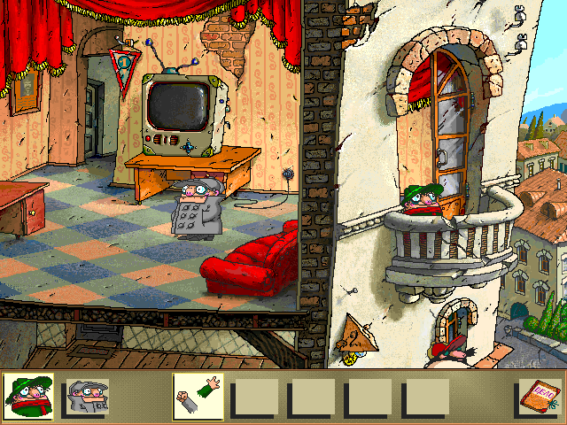
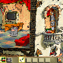
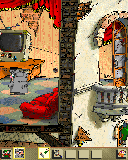

# Комната с телевизором и балконом — 0.14.0

Следующая локация после холодильника перенесена из секции 12 `PILOTS.EXE`.
Её номер в движке J2ME — 10. После завершения гостиницы оба персонажа
выходят из комнаты, затем автоматически загружается новая сцена.
Канализация по-прежнему исключена.

## Объекты и анимации

Из оригинала извлечены начальная расстановка, карты замен объектов,
условия действий, сценарии, подписи, группы маршрутов, звуки и музыка.
Добавлены 118 общих и локальных клипов, всего 1706 кадров. В меню проверки
теперь только 42 многокадровые локальные анимации новой комнаты.
Предыдущий список гостиницы удалён из текущей сборки.

| Объект | Исходные ID |
| --- | --- |
| Шеф / Коллега | 12 / 11 |
| Диван / балкон | 15 / 16 |
| Мухобойка в комнате / в инвентаре | 17 / 18 |
| Ящики | 22, 23, 24 |
| Бумага / дверца шкафа | 26 / 27, 28 |
| Шнур | 29, 30 |
| Телевизор | 31, 32, 40, 41, 42 |
| Кнопка / Гнусный Мух / тумблер | 33 / 34 / 38 |

Кадры сохраняют исходные палитры, опорные точки и последовательность.
Для одиннадцати прозрачных кадров размером 1×1 извлекатель отделяет
единственный пиксель от выравнивающего заполнения исходной записи.
Остальные размеры проверяются строго. Хранение кадров сжато без потерь.

## Позиции и взаимодействия

Используется существующий интерпретатор `HotelWorld`, расширенный для новой
секции. Различия между действиями Шефа и Коллеги сохраняются в исходном
байткоде. Позиции, изменения карт, авторские глубины и маршруты происходят
по правилам оригинала. Обычная ходьба использует глубину `69 − 3*y/16`,
то есть три слоя на один вертикальный шаг в 16 пикселей.

Сценарий включает ящики, получение мухобойки, шкаф с бумагой, подготовку
шнура, выход Коллеги наружу, неудачную попытку Шефа и взаимодействия с
тумблером. Оригинальный таймер мухи ограничивает возможность пройти дальше;
при истечении времени можно повторить действие. Финал завершается исходным
вызовом смены сцены `0e(11)`. Следующий за балконом эпизод пока не добавлен:
после финала текущая сцена остаётся завершённой.

Когда Коллега уходит на балкон, исходный сценарий отключает его контроллер.
Выбор этого персонажа через клавиши или нижнюю панель временно запрещён,
чтобы не повторять уже выполненный выход. Мухобойка отображается в нижней
строке и выбирается также через меню инвентаря.

Пять исходных глобальных переменных секции с адресами `0x1e1b54`–`0x1e1b64`
размещаются в ячейках 54–58 состояния J2ME. Снимок `PSV2 / HWS1` сохраняет
сценарий, персонажей, объекты, пути и таймеры. Прежние сохранения гостиницы
читаются с прежними исправлениями финала.

## Диалоги и звук

Русские подписи объектов показываются над сценой. Общие ответы братьев
«Ничего не понимаю» имеют субтитры. Отдельных встроенных текстовых реплик
в сценарии новой секции нет; оригинальные разговоры и телевизионный звук
сохраняются в аудио, новая расшифровка речи не добавлялась.
Добавлены 42 исходных WAV-события и MIDI новой комнаты;
длительность MIDI — 90,35 секунды. Озвучка и эффекты запускаются исходными
сценариями, действует общий переключатель звука и пауза приложения.

## Подменю локаций

В главном меню остаётся один пункт «Локации». В нём доступны все перенесённые
сцены: ворота, двор зоопарка, звериный двор, сад, улица, вступление гостиницы,
интерьер гостиницы и комната с балконом. «Назад» возвращает в главное меню,
не меняя состояние прохождения. Выбор сцены начинает её заново; сохранение
в RMS изменяется только командой «Сохранить».

## Проверка

`BalconyWorldTest` проходит вступление, исходные ветки обоих героев,
получение мухобойки, шнур, балкон, обе реакции тумблера, истечение таймера,
повторную попытку и финал. После каждого такта состояние сравнивается с
копией, восстановленной из сохранения; проверяется и запрет выбора
отсутствующего персонажа.

`BalconyRenderTest` проходит головоломку через реальные непрозрачные
хотспоты, используя рабочий рендерер и нижнюю панель каждого профиля.
`LocationEntryTest` проверяет подменю и возврат, переход из гостиницы,
загрузку новой сцены из меню и RMS, предпросмотр и возврат в игру.

Общие проверки декодируют 856 клипов / 10246 кадров, проверяют границы
`drawRGB`, PCM/MIDI и работу аудиоплееров. Сборка выполняет компиляцию и
CLDC preverification для трёх самостоятельных профилей: 128×128, 128×160,
240×320. Дополнительная сверка готовых JAR с оригиналом подтвердила
все 118 новых клипов и неизменность 1025 прежних ресурсов в каждом профиле.
Это проверки на JVM; проверка 0.14.0 на телефонах ещё предстоит.

