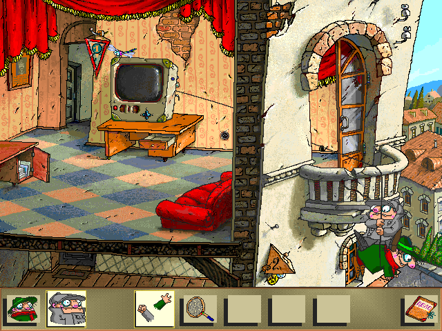
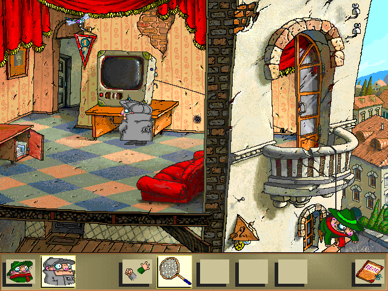

# Муха и подписи объектов — 0.14.1

Исправлены два замечания после проверки комнаты с телевизором и балконом.
Подпись «Тумблер» относится к исходному объекту 34, «Гнусный Мух» — к
объекту 38. Ранее эти подписи были переставлены. Области выбора и сами
условия взаимодействий сохранены.

## Посадка и перелёт

Исходный сценарий назначает мухе неподвижную позу, а затем запускает
одноразовый перелёт. Когда перелёт завершается, движок возвращает
сохранённую позу. В 0.14.0 при этом оставался признак завершённой анимации.
Первое правило объекта 38 снова считало анимацию оконченной и включало
позу на вымпеле, перекрывая назначенную сценарием посадку на телевизор.

При возврате к сохранённой позе признак завершения теперь сбрасывается:
проверка окончания относится к текущей анимации. Муха остаётся на
телевизоре и не перескакивает на вымпел без действия игрока. После
исходного взаимодействия проигрывается перелёт и удерживается поза
на вымпеле. Используются исходные клипы 108/109, 112, 110 и 111;
правила, маршруты, таймеры головоломки и кадры не менялись.

## Сохранения

Форматы `PSV2 / HWS1` сохранены. При загрузке снимка 0.14.0 с мухой в
неправильной позе на вымпеле и исходной фазой 2 восстанавливается нужная
поза на телевизоре. Этап головоломки, персонажи и предметы не сбрасываются.
Сохранения во время перелёта и правильная поза на вымпеле сохраняются.

Проверочный снимок `balcony-0.14.0-fly-tv.psv` получен настоящими действиями
в опубликованной версии 0.14.0: ящик, мухобойка, шнур обоими героями,
выход Коллеги на балкон и первая попытка Шефа. В старом движке после
30 тактов ожидания муха имеет клип 111 вместо 109. Проверка нового движка
загружает этот снимок, проверяет восстановленную позу и последующий перелёт.

## Проверки

- Полное прохождение комнаты с телевизором и балконом, ожидание 90 тактов
  на телевизоре без взаимодействия, перелёт после действия и ожидание
  90 тактов на вымпеле. После каждого такта сравнивается состояние с
  копией, восстановленной из сохранения.
- Загрузка снимка 0.14.0 с ошибочной позой и продолжение действий.
- Подписи тумблера и мухи проверяются через видимые непрозрачные хотспоты
  рабочего рендерера; головоломка проходится через эти же хотспоты.
- Регрессии прежней гостиницы: ванная, холодильник, финал, выход обоих
  героев и старые сохранения. Общие проверки остальных локаций,
  отрисовки, звука и самостоятельных профилей 128×128, 128×160, 240×320.

Сравнение готовых JAR с 0.14.0 подтвердило: изменены только версия в
манифесте и классы `HotelScene` / `HotelWorld`. Остальные ресурсы, включая
кадры, звуки, музыку и байткод исходных сценариев, побайтово совпадают.

Проверки выполняются на JVM. Проверка версии 0.14.1 на телефонах предстоит.

