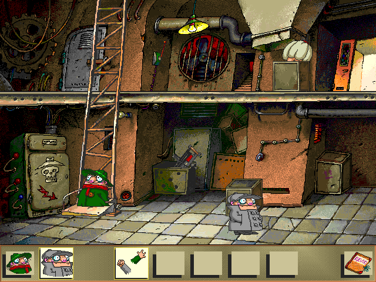
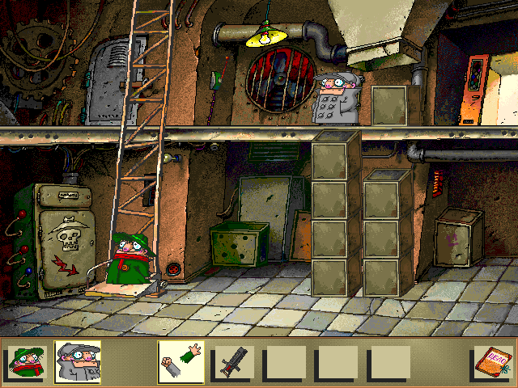
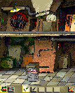

# Подвал — 0.18.0

После электрощитовой перенесён подвал: секция 17 `PILOTS.EXE`, сцена 15
движка. Порядок определён исходными вызовами переходов: электрощитовая
вызывает `0e(15)`, а подвал после завершения — `0e(14)` (крыша, секция 16).
Поэтому подвал идёт раньше крыши, несмотря на числовые ID ресурсов.

Переход из электрощитовой подключён после завершения спуска обоих героев.
Прямой запуск «Подвал» добавлен в подменю «Локации». Крыша пока не включена:
после финала показывается «Подвал пройден». Исключённая канализация не возвращена.

## Объекты и позиции

Перенесены 43 определения объектов, 405 правил, исходные карты, группы, случайные варианты,
предикаты действий и последовательности анимаций. Используются исходная сетка
64×16, опорные точки, маски и слои. Нижняя панель отображает братьев, руку
и полученный автомат; выбор доступен также через меню инвентаря.

| Объект | ID в оригинале |
| --- | --- |
| Коллега и временные формы его подхода к ящику | 15 / 12 / 13 |
| Шеф: покой, финал, ходьба, автомат, прыжки и падения | 16–20 |
| Ящик с автоматом | 14 |
| Отдельные экземпляры падающих и стоящих ящиков | 24 |
| Электричество | 31 |
| Автомат в инвентаре | 33 |
| Карбофос | 36 |

Здесь герои и ящики управляются исходными объектами карты, а не обычным
сценарием подхода к точке из предыдущих комнат. Сохранены положения
верхней площадки, лестницы и ступеней из ящиков. Шеф поднимается по ящикам,
Коллега затем поднимается по лестнице, и оба уходят по верхней площадке.

## Анимации

Добавлены 95 клипов и 1291 кадр. Пиксели, палитры и опорные точки взяты
из оригинала. Клип 80 содержит четыре авторских положения Шефа с автоматом:
направления 1, 3, 5 и 7. Они упакованы в четыре кадра одного ресурса;
движок выбирает кадр по направлению, сохраняя исходную логическую длительность
позы в один такт. Остальные клипы сохраняют свои последовательности.

Список проверки очищен: в нём только 35 многокадровых анимаций подвала.
Игровые ресурсы прежних локаций сохранены.

## Взаимодействия

Коллега достаёт автомат из ящика; Шеф использует его и прыгает по ящикам.
Перенесены броски Карбофоса, движение и оседание ящиков, попадания,
падения, реакции героев, выстрелы и исходные условия выхода на верхнюю
площадку. Решение не заменено фиксированной последовательностью действий.

Для управления восстановлены два независимых канала исходного нажатия:

- непрозрачный пиксель спрайта определяет конкретный экземпляр объекта;
- клетка карты под курсором определяет направление и цель движения.

Это позволяет нажимать на верх ящика и одновременно задавать прыжок
к клетке над ним. Выбор одного ящика не срабатывает для всех объектов
с таким же ID. Отмена маршрутного нажатия не отменяет взаимодействие со
спрайтом. Восстановлены прямое направление, поиск пути, маркеры подхода,
активные/спящие состояния клеток и ожидание анимации при перемещении.

Небольшая адаптация финала: при запуске выхода сбрасывается таймер фонового
смеха Коллеги. В исходных предикатах подъём по лестнице привязан к точным
тактам; совпадение первого шага с фоновой анимацией на такте 700 иначе
пропускало этот шаг и блокировало завершение. Остальные условия и маршрут
финала выполняются исходным байткодом.

## Звук и подписи

Добавлены 30 WAV без изменения исходных PCM-сэмплов и MIDI длительностью
109,71 секунды (7135 событий). Звуки действий, реплики, броски, выстрелы
и шаги запускаются исходными сценариями. Подписи объектов русские; добавлена
справка по прыжкам и выбору автомата. Новая текстовая расшифровка всех
аудиореплик не добавлялась.

## Сохранения и проверки

Снимок сцены 15 сохраняет глобальные переменные секции, состояния и подложки
клеток, локальные переменные каждого экземпляра, направление, ожидание
анимации и ещё не обработанное нажатие. Форматы предыдущих сцен сохранены.

`BasementWorldTest` проходит всю головоломку обычными действиями из
`basement-route.csv`, включая четыре высоты, автомат, падающие ящики,
повреждения, лестницу и выход обоих братьев. После каждого такта состояние
сравнивается с копией, заново восстановленной из сохранения. Две временные
последовательности охватывают совпадение финала со смехом и выход вне него:
всего 1412 тактов с проверкой восстановления. Переменные решения не
подставляются принудительно.

`BasementRenderTest` повторяет прохождение через реальные непрозрачные
хотспоты `HotelScene.request`, проверяет отдельные экземпляры ящиков,
подписи, нижнюю панель, все четыре положения автомата и видимый выход.
`LocationEntryTest` проверяет переход из электрощитовой, подменю, RMS
до и после получения автомата и новый каталог предпросмотра.

`BasementAssetsTest.py` независимо сверяет каждый пиксель и опорную точку
95 клипов с секцией 17, включая направления клипа 80, а также исходные
определения, предикаты, тела правил и карты в упакованном VM. Контроллер 26
с исходными подписями заменён русскими подписями интерфейса; контроллер 13
с игровым сценарием сохранён.

Независимая сверка JAR подтвердила CRC и JAD; 1692 прежних ресурса каждого
профиля побайтово совпадают с 0.17.1. Результаты сохранены в
`j2me/analysis/basement-assets-audit.json` и `basement-release-audit.json`.

Полная сборка проверяет все прежние локации, декодирование кадров, звук,
сохранения, CLDC preverification и три независимых профиля. Это проверки
на JVM; необходим следующий тест на устройствах.

