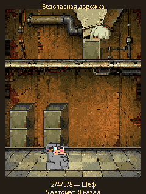
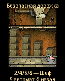
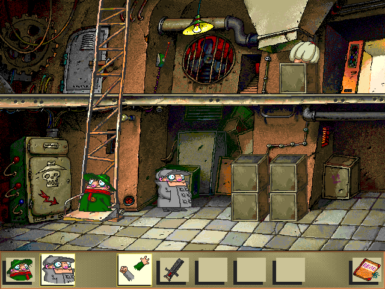

# Подвал: компактное поле и правила бросков — 0.19.2

Исправлены получение автомата обоими братьями, размеры отдельного экрана,
контакты ящиков, дублирование Слуги и условия бросков.

## Автомат у обоих братьев

Шеф и Коллега могут получить автомат. Для Шефа после подхода к ящику
запускается исходный контроллер 18: анимация 94, звук 1, выдача предмета
исходной картой 4 и завершение действия. Коллега использует свой прежний
исходный сценарий и анимацию 82. Инвентарь общий для обоих.

Подсказка, ограничивавшая получение автомата Коллегой, удалена из игры
и справки; её остаток в старом сохранении убирается при загрузке.
Само получение предмета не заменено мгновенной выдачей без анимации.
Сохранение и восстановление работают во время подхода и анимации.

## Только игровая часть

Логическое поле уменьшено с 256×176 до 128×160. Четыре доступные колонны
занимают всю его ширину: центры `16, 48, 80, 112`. Неиспользуемая левая
часть комнаты исключена. Поле целиком вписывается в доступную область
экрана с сохранением пропорций. На 240×320 оно занимает почти всю высоту
между подписью состояния и строками управления.

Новый фон содержит только стену, трубу, верхнюю площадку и пол; персонажи
и ящики на нём не нарисованы. Источник —
`j2me/assets/basement-platform-background.png`. В JAR попадает только
его индексированная версия 128×160. Изображение подготовлено по
оригинальному подвалу как визуальному образцу; все игровые спрайты
по-прежнему извлекаются из исходной игры.

## Пол, ступени и Слуга

Для линии ящиков используется пол `y=132`. Высота ступени — 18 логических
пикселей, что соответствует исходному шагу 48 пикселей при масштабе 3/8.
Дно ящика совпадает с полом, а верхние ящики опираются на нижние.
Расчёт поверхности для Шефа использует тот же шаг.

Слуга рисуется один раз, с неизменной опорой `(86,48)` под трубой. Положение
не зависит от колонки, выбранной Шефом. Используются оригинальные спрайты
86 и 62. Выброшенный ящик летит от Слуги к отмеченной колонне; персонаж
за ним не перемещается. Второй фигуры, слитой с фоном, больше нет.

## Безопасная линия

Бросок запускает только принятое движение по линии ящиков, включая вход
на неё кнопкой `2`. Движение `4/6` по безопасной дорожке, ожидание на ней
и выстрелы не запускают новые броски.

Если Шеф отступает кнопкой `8` до отпускания ящика, замах отменяется.
Уже выпущенный ящик продолжает полёт и падает на опасную линию; безопасная
дорожка защищает от попадания. При открытии старого сохранения отменяется
оставшийся замах, который прежняя версия запустила на безопасной дорожке.
Высоты колонн и полученные предметы сохраняются.

## Проверки

- `BasementWorldTest`: автомат с исходными анимациями у каждого брата,
  безопасная ходьба без бросков, отмена замаха, пауза и восстановление,
  попадание, стрельба и полный выход. Состояния после каждого такта
  сравниваются с копией, заново восстановленной из сохранения.
- `BasementTestRoute`: полный маршрут только обычными кнопками. Для
  строительства нужно выйти на опасную линию, дождаться выпуска ящика
  и отступить; на безопасной дорожке можно подготовить ступени автоматом.
  Переменные решения принудительно не меняются.
- `BasementRenderTest`: исходная анимация Шефа 94, получение предмета
  Коллегой, непрерывный контакт спрайтов от пола до вершины каждой
  колонны, активная ширина поля, сцена с исходными спрайтами и финал.
- `LocationEntryTest`: реальный экран MIDlet, отсутствие броска при
  безопасной ходьбе, таймер опасной линии, пауза, RMS, решение через
  цифровые клавиши и автоматический возврат.
- `BasementPlatformAssetsTest.py`: чистый фон 128×160 и точное
  соответствие индексов цветов и опорных точек оригинальных спрайтов.

Независимая сверка JAR подтвердила CRC и размеры в JAD. Из прежних
графических ресурсов изменились только фон отдельного экрана и масштаб
спрайтов Слуги; исходные клипы и звуки сохранены побайтово. Результаты —
`j2me/analysis/basement-layout-release-audit.json`.

Проверки на JVM выполнены для 128×128, 128×160 и 240×320; требуется
следующий тест на устройствах.

