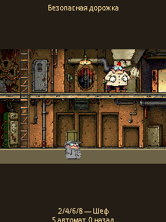
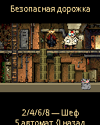
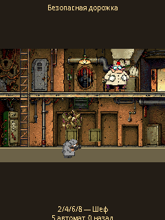

# Подвал: отдельный экран с ящиками — 0.19.0

Участок с падающими ящиками адаптирован для кнопочного телефона.
Вместо выбора точных пикселей и клеток в перспективе открывается
отдельный экран с прямым управлением Шефом, автоматическими прыжками
и двумя явно разделёнными линиями движения.

## Вход и возврат

Выберите Шефа и укажите область ящиков справа: `x ≥ 336`,
`160 ≤ y < 417` в координатах исходной сцены. Открывается `BasementCanvas`.
При одном лишь появлении Шефа или открытии экрана Слуга не бросает ящики.
Бросок запускается после первого принятого перемещения Шефа.

`0` или команда «Назад» возвращает в подвал в любой момент, включая
прыжок, выстрел и падение ящика. Можно выбрать Коллегу и достать автомат
из исходного ящика. При повторном входе сохраняются ступени, положение
Шефа, начатые анимации и стадия броска. Пока открыт обычный подвал,
таймер сегмента остановлен. Расположение уже поставленных ящиков
отражается и в общей сцене.

## Управление

| Кнопка | Действие |
| --- | --- |
| `2` / вверх | Перейти с безопасной дорожки на линию ящиков |
| `8` / вниз | Отступить на безопасную дорожку |
| `4` / влево | Сдвинуться в соседнюю колонну слева |
| `6` / вправо | Сдвинуться в соседнюю колонну справа |
| `5` / центральная | Выстрелить в ящик выбранной колонны, если автомат получен |
| `0` / «Назад» | Вернуться в подвал |

На линии ящиков переход к соседней ступени автоматически сопровождается
прыжком. За один прыжок можно подняться на одну ступень. Слишком высокая
ступень не телепортирует героя наверх: экран показывает подсказку.
Цель — добраться до верхней площадки по ступеням из ящиков.

Безопасная дорожка находится перед линией падения. Ящики не попадают
в стоящего на ней Шефа. Автомат работает только с этой дорожки;
без предмета или на опасной линии выстрел не выполняется и показывается
объяснение. Повторное нажатие огня не сбрасывает уже идущую анимацию.
Во время выстрела можно перемещаться вдоль безопасной дорожки, а переход
к ящикам доступен после завершения выстрела.

## Броски, разрушение и восстановление управления

Слуга бросает по одному ящику в колонну, выбранную перемещением Шефа.
Сначала он поднимает ящик; жёлтая вертикальная отметка показывает место
падения. Предупреждение занимает примерно 1,1 секунды, падение — ещё
одну секунду. Пока Шеф стоит, новые броски не повторяются автоматически.
Четыре ступени — предельная высота колонны.

Попадание на опасной линии отбрасывает Шефа на безопасную дорожку.
Короткая анимация отхода занимает четыре такта; затем можно двигаться
дальше. Переигрывать локацию из-за попадания не требуется.

Выстрел не удаляет ящик сразу. В течение 18 тактов показываются
раскол, разлетающиеся доски и открытый ящик с шарами. Только после
последней стадии число ящиков уменьшается. При совпадении выстрела
с новым броском запоминается конкретная ступень: разрушение не
перепрыгивает на только что упавший ящик.

Для управления сегментом используется собственное состояние, поэтому
исходные флаги занятости и ожидания анимаций не могут оставить Шефа
заблокированным после выстрела.

## Графика и исходные сценарии

Создан новый фронтальный рисунок подвала и спрайты плоских ящиков,
четырёх стадий разрушения/шаров и четырёх поз Слуги. Источник —
`j2me/assets/basement-platform-atlas.png`; рисунок подготовлен генератором
изображений по оригинальному фону и спрайтам как визуальным образцам.
`extract_basement_platform.py` разрезает атлас, выделяет прозрачность по
пурпурной подложке и преобразует кадры в индексированные ресурсы.
В JAR включаются только восемь подготовленных ресурсов, без большого PNG.

Логическая сцена — 256×176. Она целиком помещается на экран телефона
без прокрутки. Для Шефа используются масштабированные оригинальные
позы, ходьба, прыжок и анимация автомата 53. Исходные 95 клипов подвала
и его VM остаются неизменными; новые рисунки имеют отдельные имена
в `puzzles/`.

В общей комнате остановлены исходные контроллеры повторяющихся бросков
и ящиков. Взятие автомата Коллегой, музыка и звуковые ресурсы остаются
исходными. Когда Шеф достигает верхней площадки, отдельный экран
закрывается автоматически, и управление возвращается исходному
контроллеру 17: поздравительная анимация Шефа, подъём Коллеги по лестнице
и уход обоих героев по верхней площадке.

## Сохранения и совместимость

В снимок HWS1 сцены 15 добавлен необязательный хвост `BSP1` из 24 целых
чисел: колонна и линия героя, высоты, движение, бросок, выстрел и его
конкретная ступень, подсказки и состояние завершения.

При загрузке незавершённого участка из 0.18.0 старые состояния прыжка,
выстрела и падающих ящиков заменяются начальным состоянием нового
сегмента. Полученный автомат и сценарий его взятия сохраняются.
Уже завершённый подвал и ранее начатый исходный выход не обнуляются.
Форматы остальных локаций не менялись. Выход через `0` сохраняет прогресс
в текущей игре; запись на диск выполняется обычной командой «Сохранить».

В `basement-0.18.0-shot.psv` находится снимок опубликованной 0.18.0,
сделанный сразу после выстрела. Проверка загружает его новым движком,
сохраняет автомат и подтверждает, что отдельный экран снова управляется.
Снимок `basement-0.18.0-exit.psv` проверяет уже начатый выход: он
продолжается без повторного открытия головоломки.

## Проверки

- `BasementWorldTest`: ожидание после появления и открытия, бросок после
  движения, попадание и восстановление, безопасная дорожка, ограничения
  автомата, полный цикл разрушения до удаления, выход за предметом,
  возвращение, построение лестницы обычными кнопками, автоматические
  прыжки, исходный финал. Сравнение с заново загруженной копией после
  каждого такта; также загрузка снимка 0.18.0.
- `BasementRenderTest`: реальное получение автомата и зона входа,
  индексированный фон, новые спрайты, стадии разрушения, прыжки
  и возвращение в исходную сцену. Отдельно для трёх разрешений.
- `LocationEntryTest`: настоящий `BasementCanvas`, цифровые клавиши,
  работа общего таймера, пауза скрытого экрана, возврат, сохранение
  и восстановление в RMS, автоматическое закрытие после решения.
- `BasementPlatformAssetsTest.py`: происхождение атласа, размеры,
  прозрачность, структура кадров и одинаковые рисунки в трёх профилях.
  Прежний `BasementAssetsTest.py` продолжает проверять все исходные
  спрайты и VM подвала без изменений.

Независимая сверка подтверждает побайтовую сохранность всех прежних
ресурсов JAR, кроме обновлённых классов и манифеста. Новая графика занимает
54 315 байт в сжатом JAR каждого профиля. Результаты CRC, JAD и SHA-256
записаны в `j2me/analysis/basement-platform-release-audit.json`.

Проверки выполняются на JVM и не заменяют тест на реальном телефоне.

