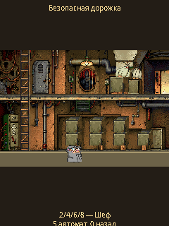
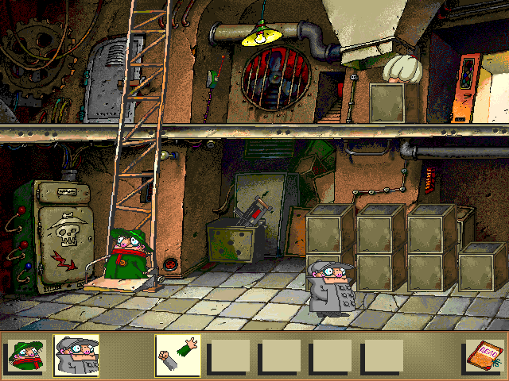
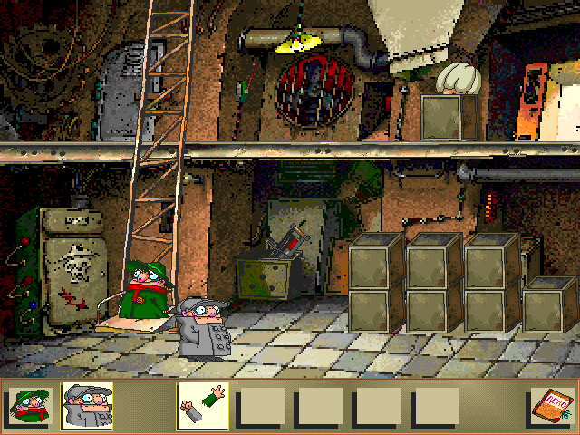

# Оригинальные спрайты и возврат из мини-игры — 0.19.1

На отдельном экране подвала восстановлены оригинальные спрайты ящиков,
Слуги и Шефа. Исправлены перекрытия ящиков после возврата и ходьба Шефа
по общей комнате, включая подход к ящику с автоматом.

## Спрайты

| Объект | Исходные клипы |
| --- | --- |
| Стоящий ящик | 50 |
| Открытие ящика и вылетающие шары | 72, все 22 кадра |
| Слуга в покое / бросок | 86 / 62 |
| Шеф: покой, ходьба, прыжок, автомат | общие 13 / 20 / 21 / 24, местный 53 |

Для небольшого экрана используется ближайшая точка без сглаживания.
Сохраняются исходные индексы цветов, палитра и взаимное положение кадров
относительно авторской опоры. Повторной квантизации, перекрашивания и
нарисованных заново спрайтов нет. Фронтальный фон и управление отдельным
экраном сохраняются.

Слуга использует исходные кадры броска, распределённые по времени
предупреждения и падения адаптированной головоломки. При выстреле теперь
последовательно показываются все 22 исходных кадра клипа 72; ящик
удаляется после завершения. Состояние мини-игры и начатые действия из
сохранения 0.19.0 продолжают загружаться.

## Перекрытия ящиков

После возврата все ящики получали одинаковый слой 14. При рисовании
по строкам карты нижний ящик оказывался поверх края верхнего. Для
ступени `n`, считая от основания, назначается слой `14 − n`: основание
рисуется раньше, верхние ящики — после него. Правило применяется также
при загрузке старого сохранения с уже построенными колоннами.

## Ходьба и автомат

В обычной комнате больше не выполняются старые контроллеры прыжков,
выстрелов и маркеров исходной головоломки. Ходьба Шефа использует
отдельный маршрут по свободным клеткам пола и оригинальные походки.
Она восстанавливается из сохранения посреди шага.

После выхода можно подойти Шефом к ящику с автоматом. Получение самого
предмета остаётся за Коллегой, как в оригинальной сцене; при необходимости
появляется подсказка «Автомат достанет Коллега». Если Шеф занял место
подхода, он сначала отходит вниз, затем Коллега выполняет исходную
анимацию взятия. При этом прогресс отдельного экрана сохраняется.

В сохранениях 0.19.0 старое действие Шефа могло оставить невидимый маркер
34 в точке подхода и убрать объект 14. При загрузке такие остатки
удаляются, флаги старого действия сбрасываются, а ещё не полученный ящик
с автоматом восстанавливается. Инвентарь, колонны и состояние мини-игры
сохраняются. Исправление помечается в свободной переменной 63 сцены 15;
формат HWS1/BSP1 не меняется. Начатая завершающая сцена не сбрасывается.

## Проверки

- `BasementWorldTest` проходит возврат, ходьбу Шефа, освобождение места
  для Коллеги и получение автомата, затем всю головоломку и исходный
  финал. Состояния сравниваются с восстановленными копиями после каждого
  такта. Добавлен реальный снимок 0.19.0 после возврата и неудачного
  взаимодействия с ящиком: `basement-0.19.0-return.psv`.
- `BasementRenderTest` проверяет непрозрачные пиксели на перекрывающихся
  краях ящиков: каждый видимый пиксель верхнего должен остаться его
  исходного цвета. Проверяются также реальные хотспоты, ходьба и финал.
- `BasementPlatformAssetsTest.py` независимо сверяет каждый отображаемый
  индекс пикселя и опорную точку с исходными кадрами всех спрайтов.
- Полная сборка проверяет три разрешения, прежние локации, RMS,
  музыку, звук и CLDC preverification.

Дополнительная сверка JAR подтверждает CRC и размеры в JAD; изменения
графических ресурсов ограничены семью файлами спрайтов отдельного экрана.
Исходные клипы, фоны и звуки прежних сцен побайтово сохранены. Результат —
`j2me/analysis/basement-return-release-audit.json`.

Это проверки на JVM; требуется очередной тест на устройствах.

