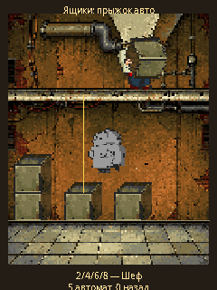
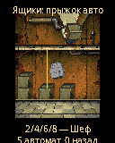

# Подвал: прицеливание Слуги — 0.19.3

Слуга выбирает колонну, где Шеф стоит перед прыжком, и сохраняет её
на время замаха и полёта. Переход на соседний ящик не переносит прицел
в место приземления.

Если Шеф остаётся на опасной линии после завершения предыдущего броска,
Слуга снова берёт его текущую позицию в прицел. Нажимать направление
для активации не требуется. Это действует и при ожидании на ящике.
При начале нового прыжка до следующего такта цель фиксируется по
исходной колонне Шефа.

Безопасная дорожка по-прежнему не запускает броски. Отступление до
отпускания ящика отменяет замах, а уже летящий ящик продолжает полёт.
Слуга остаётся под трубой. Графика, размеры поля, получение автомата
обоими братьями и исходный финал сохранены.

Формат сохранения не изменён: целевая колонна и стадия броска уже
хранились в BSP1. При восстановлении продолжается тот же бросок с той
же целью. Новые броски используют исправленное правило.

## Проверки

`BasementWorldTest` проверяет, что цель начатого броска не меняется во
время прыжка, новый бросок перед уходом выбирает исходную колонну,
ожидание на опасной линии запускает прицел без ввода и восстановление
сохранения сохраняет цель. Полная цепочка строит ступени обычными
кнопками, затем заканчивает исходную локацию.

`BasementRenderTest` отдельно ставит Шефа на ящик, ждёт нового прицела
без перемещения и делает снимок в середине прыжка. Жёлтая отметка
остаётся у покинутого ящика. `LocationEntryTest` проходит тот же сценарий
решения через реальный экран MIDlet, с паузой и RMS.

Проверки выполняются для трёх разрешений на JVM; следующий этап —
проверка на устройствах.

