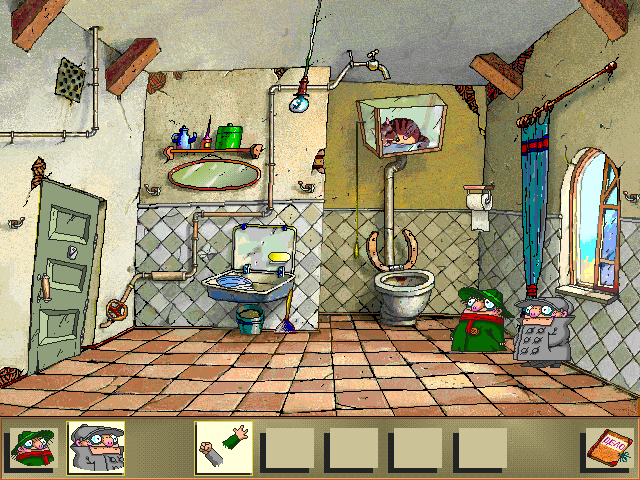
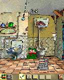
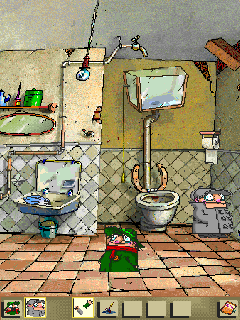

# Ванная комната — 0.16.0

Следующая после карниза локация перенесена из секции 14 `PILOTS.EXE`.
В движке J2ME её номер — 12. После совместного ухода с карниза комната
загружается автоматически; отдельный запуск доступен в «Локациях».

## Объекты и анимации

Перенесены начальная расстановка, определения объектов, карты замен,
группы проходов, условия взаимодействий и сценарии обоих персонажей.
Русские подписи сопоставлены с исходными флагами наведения.

| Объект | Исходный ID |
| --- | --- |
| Шеф / Коллега | 12 / 11 |
| Ручка двери / выход | 15 / 16 |
| Мыло в комнате / в инвентаре | 17 / 24 |
| Кран | 18 |
| Рулон | 19 |
| Шнурок бачка | 20 |
| Вантуз в комнате | 21 |
| Вантуз в инвентаре, варианты | 22, 23 |
| Вантуз, установленный у бачка | 25 |
| Унитаз / кот / умывальник | 26 / 28 / 31 |

В старой таблице подписей присутствует щётка, но действующего объекта
щётки в этой секции нет. Второй переносимый предмет — мыло; это подтверждают
его сценарий, картинка в комнате 78 и значки инвентаря 79/80. Неиспользуемые
подписи не создают дополнительных объектов.

Добавлены 95 общих и локальных клипов, всего 1462 кадра. Палитры, опорные
точки, последовательности и длительности кадров сохраняются. В «Анимациях»
теперь только 27 многокадровых локальных клипов новой комнаты; предыдущий
список карниза удалён из текущего JAR, игровые ресурсы прежних сцен сохранены.

## Позиции и взаимодействия

Сохраняются авторские координаты объектов и маршруты. Начальные корни:
Шеф `(512,352)`, слой 12; Коллега `(448,336)`, слой 15. Обычная ходьба
использует зависимость `78 − 3*y/16`, то есть три слоя на вертикальный шаг
16 пикселей. При подходах и совместных действиях глубины задаёт исходный
байткод, включая временные поправки во время взаимодействий с бачком.

Рабочая цепочка головоломки:

1. Подобрать вантуз и мыло; оба предмета доступны в нижней строке.
2. Шеф взаимодействует с краном: появляется ограниченная по времени
   возможность взаимодействия с котом.
3. Коллега использует мыло на коте в это время.
4. Шеф устанавливает вантуз у унитаза.
5. Коллега взаимодействует со шнурком бачка.
6. Шеф забирает установленный вантуз и применяет его к ручке двери,
   пока сохраняется нужное состояние предмета.
7. Проигрывается исходный выход обоих братьев.

Различия правильных и неправильных действий сохранены. Истечение первого
окна взаимодействия с котом не блокирует прохождение: цепочку можно
повторить. Для вантуза действует исходный таймер 400 тактов; его промежуточная
фаза наступает на 200-м такте. По истечении срока вантуз остаётся в
инвентаре, но прежнее действие у двери больше не завершает головоломку.

Нижняя строка показывает исходные значки сухого вантуза 52/53, двух
временных состояний 54/55 и 56/57, мыла 79/80. Выделение использует границы
текущего значка. Предметы доступны также через меню инвентаря.

После действия Шефа исходный сценарий передаёт управление Коллеге и задаёт
ему маршрут к выходу. На этой фазе сохраняется признак продолжения маршрута;
сцена не завершается до вызова `0e(13)` из контроллера Коллеги. Следующая
после ванной локация пока не добавлена.

## Диалоги, звук и сохранения

Добавлены 46 WAV-событий и MIDI секции. Длительность MIDI — 109,71 секунды.
Реплики, реакции, шум воды, действия с бачком и предметами запускает
исходный сценарий. Общие ответы братьев используют прежние субтитры;
отдельная новая расшифровка аудиореплик не добавлялась. Над сценой
отображаются русские подписи объектов. Пауза и выключатель звука общие.

Снимки `PSV2 / HWS1` сохраняют объекты, персонажей, пути, таймеры и текущую
фазу действий. Пять больших исходных адресов `0x1e1b54`–`0x1e1b64`
размещены в ячейках 54–58 состояния этой сцены. Для периодических условий
добавлены исходные операции деления с остатком и обмена регистров:
их семантика проверена по инструкциям `00408ff4` и `00408f90` оригинала.
Предыдущие сохранения и исправления карниза продолжают поддерживаться.

## Проверки

`BathroomWorldTest` проходит исходные начальные ветки обоих героев,
проверяет отказ с сухим вантузом, истечение окна кота и повторную попытку,
сотрудничество у бачка, обе фазы таймера, истечение срока вантуза и выход.
Состояние после каждого такта сравнивается с восстановленной копией
сохранения, включая финальное движение второго персонажа.

`BathroomRenderTest` проходит ту же цепочку через реальные непрозрачные
хотспоты, проверяет подписи и смену значков в нижней строке. Вход из меню,
переход с карниза, RMS и предпросмотр проверяет `LocationEntryTest`.

Полная сборка проверяет 1027 клипов / 12864 кадра, 363 WAV и 11 MIDI,
границы `drawRGB`, прежние локации, звук, меню, сохранения, JAD и CLDC
preverification. Профили 128×128, 128×160 и 240×320 остаются отдельными
приложениями. Проверки выполняются на JVM; проверка 0.16.0 на устройствах
ещё предстоит.

Независимая сверка готовых JAR с секцией 14 подтвердила все 95 новых
клипов / 1462 кадра. В каждом профиле 1295 прежних ресурсов и сценариев
побайтово совпадают с 0.15.2.

