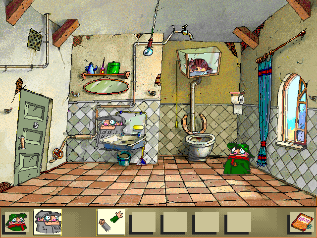

# Ванная комната — исправления 0.16.1

После успешного тестирования 0.16.0 на устройствах исправлены два замечания.

Во время исходных действий 95 и 96 (удачное и неудачное применение мыла
Коллегой к коту) подписи наведения скрыты. Раньше непрозрачный кадр
анимации попадал под курсор на бачке, и над катсценой появлялось «Коллега».
После завершения действия обычные подписи возвращаются. Реплики и звуки
продолжает запускать исходный сценарий.

Умывальник (объект 31, клип 94) отрисовывается в плоскости пола `y=320`,
на слое 18. Его исходный слой 26 относился к корню спрайта на стене
`(256,256)` и пропускал персонажа перед чашей уже на подходах `y=288/304`.
Теперь на этих подходах чаша закрывает персонажа, а на переднем проходе
`y=320` персонаж закрывает чашу. Слои остальных объектов сохранены.

При ходьбе в ванной слой отрисовки персонажа рассчитывается по текущей
видимой координате, с сохранением сценарных поправок к глубине. Логический
корень уже содержит следующую клетку маршрута; использование только этого
корня переключало перекрытие до завершения промежуточных кадров шага.
Изменения не затрагивают координаты, пути и формат сохранений.

`BathroomRenderTest` проверяет фактические пиксели пересечения чаши и
обоих персонажей на трёх глубинах, в четырёх позах покоя и промежуточных
кадрах ходьбы. Через реальные хотспоты проходят обе сцены с мылом:
неудачная попытка сохраняет предмет, затем успешная продолжает головоломку.
Во время каждой сцены проверяется отсутствие подписи на видимых пикселях
Коллеги. Далее тест проходит сотрудничество у бачка, таймер вантуза и
выход обоих братьев.

Полная сборка выполняет проверки всех предыдущих локаций, сохранений,
звука, меню и декодирования анимаций для отдельных профилей 128×128,
128×160 и 240×320. Проверки 0.16.1 выполняются на JVM; сборки предназначены
для следующего теста на устройствах. Перенос следующей локации в эту
версию не включён.

Независимая проверка готовых JAR подтвердила CRC, версию и размер из JAD,
а также побайтовое совпадение всех 1448 ресурсов каждого профиля с 0.16.0.

