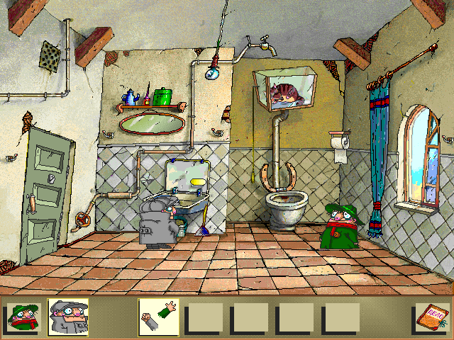
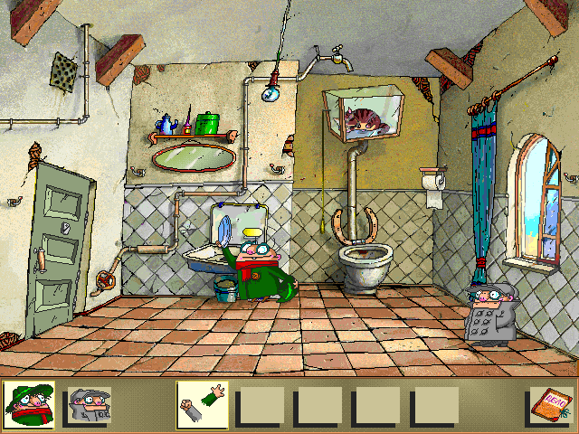
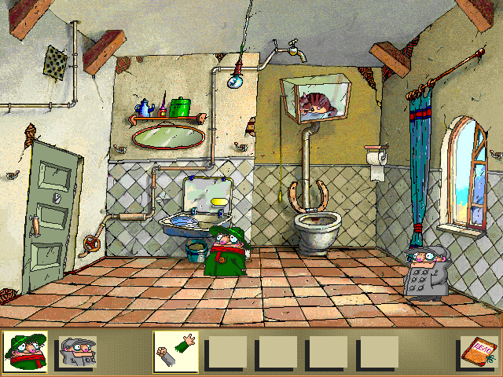

# Проход перед умывальником — 0.16.2

После уточнения по скриншотам пересмотрено исправление 0.16.1:
персонажи должны оставаться перед умывальником, на достаточном расстоянии
от чаши. Перенос чаши на передний слой отменён; возвращён исходный слой 26.
Скрытие подписи Коллеги в сценах с мылом сохранено.

## Граница прохода

Для свободной ходьбы закрыта область корней персонажей `x=192/256, y<336`.
Ближайшая обычная позиция слева от чаши — `(192,336)`, по примеру второго
скриншота. В этих координатах персонаж остаётся перед раковиной, а не
скрывается за ней. Ограничение учитывают ручной поиск пути и поиск
маршрута исходными контроллерами. Обычный проход идёт по полосе пола
перед тумбой, вместо пересечения её верхней части.

Исходная позиция умывания Коллеги `(256,320)` оставлена только для конечной
точки взаимодействия с умывальником. К ней допускается подход по исходному
маркеру действия 23; сквозной проход через эту клетку закрыт. Клип 95
играет в исходных координатах, перед чашей: его части остаются совмещены
с предметами на фоне. После действия Коллега видимо отходит на свободное
место перед раковиной. Если ближайшая точка занята вторым братом, поиск
пути проверяет другие точки в переднем проходе.

Сохранение старой версии с персонажем возле чаши запускает такой же отход,
сохраняя видимую ходьбу. Персонаж не переносится мгновенно. Формат HWS1/PSV2
сохранён, исходные условия головоломки, таймеры и ресурсы не менялись.

## Проверки

`BathroomRenderTest` проводит обоих братьев к ближайшей допустимой точке,
проверяет запрет двух близких точек и каждую клетку свободного маршрута.
Проверяется передняя плоскость персонажей, затем реальное взаимодействие
с умывальником, кадры исходного клипа 95 и последующий отход Коллеги.
Тест также проходит обе сцены с мылом, временные состояния вантуза и выход.

`BathroomWorldTest` восстанавливает реальное сохранение 0.16.1 после
умывания Коллеги (`bathroom-0.16.1-sink-close.psv`), проверяет начало
видимого отхода и конечную точку `(256,336)`. Состояние каждого такта
сравнивается с восстановленной из сохранения копией. Проверки прежних
ветвей и полного прохождения ванной сохранены.

Полная сборка проверяет отдельные профили 128×128, 128×160, 240×320,
предыдущие локации, меню, аудио, сохранения и декодирование анимаций.
Это проверки на JVM; версия предназначена для следующего теста на устройствах.
Независимая сверка готовых JAR подтвердила CRC, версию и размеры JAD,
а также побайтовое совпадение всех 1448 ресурсов каждого профиля с 0.16.1.

