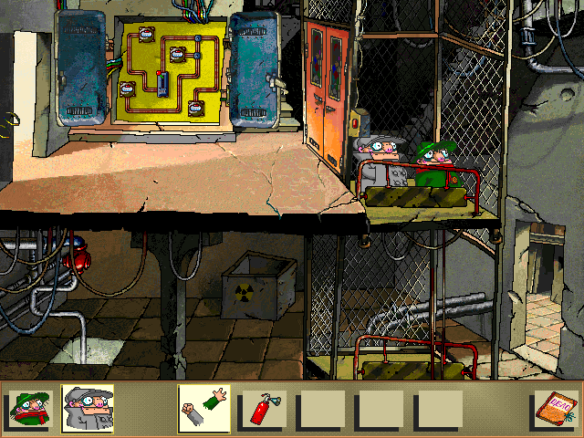
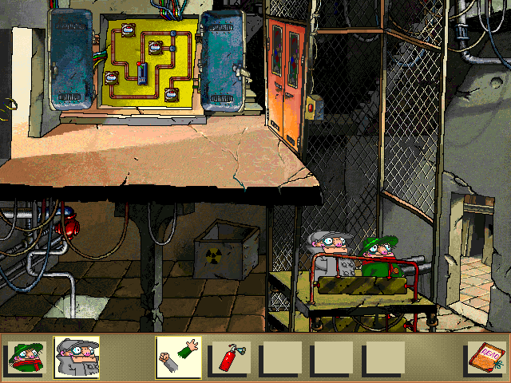

# Спуск на платформе — 0.17.1

Исправлен дубль пустой платформы в завершающей катсцене электрощитовой.

Причиной была последовательность замен объектов в одной клетке карты
`(7,25)` / `(448,400)`. Исходный объект 58 играет одноразовую анимацию
199: пустая платформа поднимается к героям. Затем карта 43 заменяет его
объектом 46, неподвижным лифтом с клипом 180. Движок ошибочно сохранял ID 58
под объектом 46 как подложку. Когда карта 52 убирала объект 46 для спуска
братьев в общем клипе 204, подложка создавалась заново и запускала клип 199
с нулевого кадра. В результате одна платформа ехала вниз с героями, вторая —
вверх без них.

При замене 58 → 46 теперь сохраняется только нижележащая основа клетки,
а отработавшая одноразовая анимация больше не восстанавливается. Исправление
ограничено этой заменой в электрощитовой. Исходные карты, анимации и события
звука не менялись. Обычный подъём пустой платформы перед посадкой сохранён.

## Сохранения

При загрузке 0.17.0 исправляются оба состояния:

- объект 46 ещё стоит на месте и ошибочно хранит под собой 58;
- спуск уже начался, а объект 58 уже восстановлен и показывает лишнюю
  пустую платформу.

В первом случае убирается ошибочная подложка. Во втором удаляется только
восстановленный объект пустой платформы. Контроллер спуска с героями и
текущая фаза его сценария продолжают работать.

## Проверки

`SwitchboardWorldTest` проверяет один исходный подъём пустой платформы,
все 60 последовательных кадров спуска и отсутствие объекта 58 во время
клипа 204. После каждого такта состояние сравнивается с копией,
восстановленной из сохранения. Добавлены реальные сохранения опубликованной
0.17.0: `switchboard-0.17.0-lift-covered.psv` и
`switchboard-0.17.0-lift-duplicate.psv`; оба должны корректно закончить сцену.

`SwitchboardRenderTest` проходит к выходу через непрозрачные хотспоты,
проверяет ровно один видимый клип 204 и отсутствие клипа 199 на каждом
кадре спуска. Снимки показывают 10-й и 30-й кадры последовательности.
Полная сборка также проверяет головоломку, RMS, звук, прежние локации,
декодирование всех кадров и независимые профили 128×128, 128×160, 240×320.
Это проверки на JVM; сборки предназначены для следующего теста на устройствах.
Независимая сверка JAR подтвердила CRC и JAD, а также побайтовое совпадение
всех 1694 ресурсов каждого профиля с 0.17.0.

