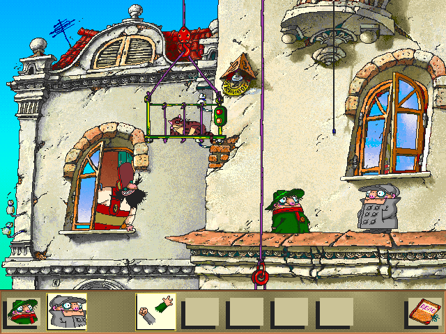
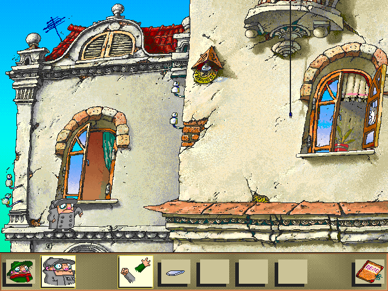
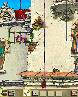

# Карниз гостиницы — 0.15.0

После комнаты с телевизором и балконом перенесён следующий эпизод:
фасад гостиницы, окна и трос. Это секция 13 исходного `PILOTS.EXE`,
сцена 11 в движке J2ME. Завершение балкона автоматически запускает её
вступление. Сцена доступна также через подменю «Локации».

## Объекты → анимации → позиции

Перенесены исходные определения объектов, начальная расстановка,
карты замен и перемещения, группы проходов и байткод правил. Русские
подписи соответствуют исходным объектам:

| Объект | Исходный ID |
| --- | --- |
| Шеф / Коллега | 12 / 11 |
| Левое окно | 15 |
| Правое окно, закрытое / открытое | 16 / 17 |
| Трос | 18 |
| Осколок на карнизе / в инвентаре | 19 / 20 |

Добавлены 76 общих и локальных клипов, всего 1156 кадров. Исходные палитры,
опорные точки, порядок и длительности кадров сохранены. В шести кадрах
78–83 клипа 52 исходная запись 1×2 содержит заполнение до 16 байт;
извлекатель сохраняет два пикселя и отделяет заполнение от изображения.

Предыдущий список предпросмотра заменён: «Анимации» содержит только
19 многокадровых локальных клипов карниза. Игровые ресурсы предыдущих
сцен остаются в сборке.

Вступление — исходный составной клип 76, 66 кадров. Отдельные контроллеры
героев появляются при исходной замене карты на шаге 66, после окончания
этого клипа. Начальные корни: Шеф `(512,320)`, Коллега `(384,320)`, слой 6
у обоих. Обычная ходьба сохраняет исходную зависимость `46 − y/8`,
то есть два слоя на вертикальный шаг 16 пикселей.

## Взаимодействия

Сценарии исполняются общим интерпретатором `HotelWorld`. У Шефа и Коллеги
сохраняются разные реакции на окна и трос. Рабочий путь головоломки:

1. Коллега взаимодействует с правым окном и открывает его.
2. Шеф взаимодействует с открытым окном; появляется осколок.
3. Любой из братьев подбирает осколок. Он отображается в нижней строке
   и доступен через меню инвентаря.
4. Шеф использует осколок на тросе.
5. Взаимодействие с левым окном запускает исходный совместный уход.
   Ведущим может быть любой из братьев; второй следует автоматически.

Неверная попытка пройти до подготовки троса сохраняет исходную реакцию
падения. После неё можно продолжить головоломку. Команда исходного
движка `2a(0)` отменяет маршрут в этой реакции; её отмена движения
восстановлена в J2ME. В оригинальном дизассемблировании это ветка
`004086c3`, сбрасывающая активный маршрут. Позиции и этапы реакции
далее задают прежние правила персонажей.

Завершение определяется исходным действием 60 и вызовом `0e(12)`.
Следующая после карниза сцена пока не добавлена: эпизод остаётся
завершённым после проигрывания ухода.

## Диалоги, звуки и музыка

Добавлены 24 исходных WAV-события и MIDI этой секции. Длительность MIDI —
80,16 секунды; сохраняются события нот и их временные отметки.
Звуки вступления, действий, падений и окон запускаются исходными правилами.
Общие ответы братьев используют прежние субтитры; отдельной новой
расшифровки аудиореплик нет. Русские подписи объектов отображаются
над сценой. Работают общий выключатель звука и пауза приложения.

## Сохранения и проверки

Форматы `PSV2 / HWS1` сохранены. Сцена 11 сохраняется и восстанавливается
как во вступлении, когда отдельные контроллеры героев ещё не созданы,
так и во время ходьбы, предметных действий, падения и совместного ухода.
Сохранения прежних локаций и исправление позы мухи 0.14.0 продолжают работать.

`FacadeWorldTest` проверяет все 66 кадров вступления, исходные ветки обоих
героев, неудачные действия, восстановление после падения, получение
осколка обоими братьями, подготовку троса и уход с обоими ведущими.
После каждого такта состояние сравнивается с восстановленной из
сохранения копией.

`FacadeRenderTest` проходит головоломку через реальные непрозрачные хотспоты,
проверяет подписи окна, троса и осколка, нижнюю панель и финальную анимацию.
`LocationEntryTest` проверяет переход балкон → карниз, вход из подменю,
сохранение вступления и игрового состояния, предпросмотр и возврат.

Полная сборка проверяет прежние локации, 932 клипа / 11402 кадра,
317 WAV и 10 MIDI, границы `drawRGB`, JAD, CLDC preverification и три
самостоятельных профиля: 128×128, 128×160, 240×320. Проверки выполняются
на JVM; проверка 0.15.0 на устройствах ещё предстоит.

Независимая сверка готовых JAR с секцией 13 подтвердила все 76 новых
клипов. 1190 прежних изображений, анимаций, аудиофайлов и сценариев
в каждом профиле побайтово совпадают с 0.14.1.

