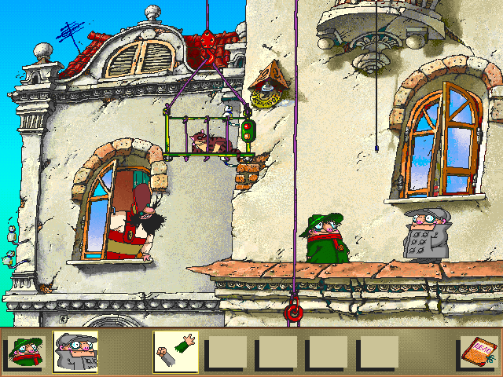
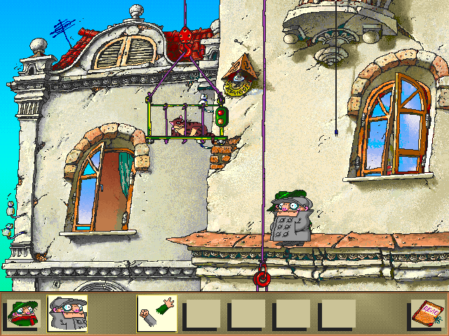

# Непрерывность вступления и подъёмник — 0.15.1

Исправлены два замечания после проверки карниза гостиницы в 0.15.0.

## Персонажи после спуска

Составной клип вступления 76 заканчивается на 66-м кадре. На исходном
шаге 66 карта 39 создаёт отдельных Шефа и Коллегу, но их обычные правила
ожидают окончания вступительного действия 90 на шаге 71. В порте новые
контроллеры до этого оставались без спрайтов: между составной анимацией
и игровыми позами возникала видимая пауза.

Теперь при этой замене карты герои сразу получают исходные позы и слои:
Шеф — 12, Коллега — 17, глубина 6 у обоих. Координаты и время передачи
управления сохранены. Вступительный клип показывается целиком, отдельные
персонажи не добавляются поверх него раньше шага 66.

## Подъёмник и трос

В оригинале `FUN_00406d80` сохраняет основной спрайт объекта при запуске
временной анимации с флагом 1. После её завершения исходное изображение
остаётся на месте. Порт ранее возвращался к постоянной позе только в
части явно обработанных сценариев и терял её у подъёмника.

Команда запуска анимации теперь сохраняет текущую постоянную позу при
замене её одноразовым клипом. Реакция подъёмника 53 возвращается к 51,
реакция троса 56 — к 54. Система остаётся видимой и после длительного
ожидания. Замена постоянной анимации обновляет основную позу.

Намеренное удаление системы после применения осколка сохранено: объекты
18 и 21 удаляются исходной картой, а их завершающие анимации 55 и 52
проигрываются отдельно. Удалённые объекты не воссоздаются.

## Сохранения

Форматы `PSV2 / HWS1` не менялись. При загрузке 0.15.0 восстанавливаются:

- позы уже созданных героев во время паузы в конце вступления;
- постоянные изображения существующих объектов подъёмника и троса;
- возврат к постоянной позе, если снимок сделан во время их реакции.

Этап прохождения, инвентарь, маршруты и время текущей анимации сохраняются.
Для системы, уже удалённой по сценарию осколком, восстановление не применяется.

## Проверки

- Все 66 кадров вступления и наличие обоих спрайтов на каждом такте
  после передачи от составной анимации отдельным героям.
- Реакция на преждевременный проход, постоянные изображения подъёмника
  и троса после неё, 90 тактов ожидания и последующее прохождение.
- Два настоящих снимка опубликованной 0.15.0: пауза после спуска и уже
  пропавшая система. Проверяется загрузка и завершение головоломки.
- Сравнение состояния с восстановленной из сохранения копией после каждого
  такта, реальные хотспоты, отрисовка после вступления и после реакции.
- Прежняя гостиница, холодильник, муха на телевизоре и вымпеле, остальные
  локации, звук, меню, сохранения, декодирование кадров и границы `drawRGB`.

Сборки самостоятельных профилей 128×128, 128×160 и 240×320 проверяются на
JVM с CLDC preverification. Сверка готовых JAR с 0.15.0 подтвердила:
изменены только манифест версии и класс `HotelWorld`; все остальные
ресурсы и байткод сценариев побайтово совпадают. Проверка 0.15.1 на устройствах ещё предстоит.

