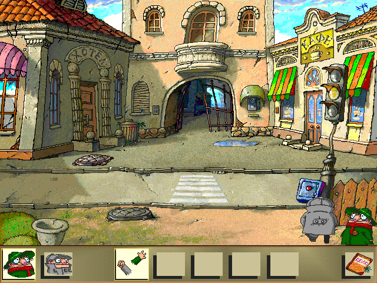
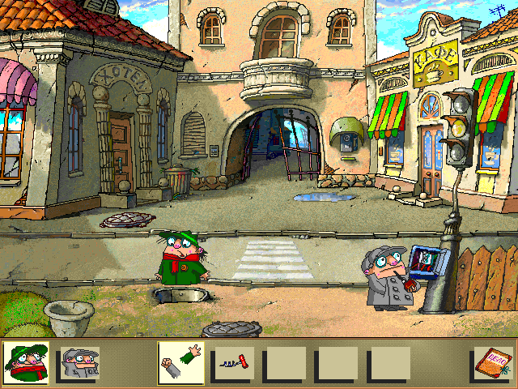

# Пятая локация — улица, 0.11.0

После поимки мартышки и подтверждения реплики с ключом открывается улица.
Добавлен отдельный пункт «Пятая локация». Внутренний номер сцены — 06;
исходные сценарии и ресурсы находятся в секции 8 закреплённого `PILOTS.EXE`.
Шестая игровая локация не добавлена: выход через люк завершает текущую сцену.

## Объекты → анимации → позиции

[Извлечение](../j2me/extract_street.py) сохраняет исходные определения,
правила, карты, кадры, опоры и палитру. В
[описи оригинала](../j2me/analysis/street-original-rules.json) записаны
контрольная сумма EXE, файловые смещения и байткоды.

| Исходный объект | Назначение | Начальная опора |
| --- | --- | --- |
| 11 | Коллега, управляемый персонаж | 576,400 |
| 12 | Шеф, самостоятельный персонаж | 512,400 |
| 16 | Та сторона улицы | 64,240 |
| 17 | Пешеходный переход | 320,288 |
| 18 | Найденный штопор | появляется в 320,384 |
| 19 | Урна | 64,400 |
| 21 / 20 | Закрытый / открытый люк | 192,320 / 192,352 |
| 22 | Штопор в инвентаре | 256,448 |
| 25 | Прохожий на другой стороне | 576,288 |
| 26 / 27 | Контроллеры транспорта и прохожего | служебные |
| 29–33 | Машины и реакции на переход | из исходных карт |
| 35 | Обитатель урны и его реакции | 128,272 |
| 36–39 | Состояния светофора | из исходных карт |

Добавлены **49 местных и 44 общих клипа, 1475 кадров**. В игре всего
482 клипа и 6020 кадров. Для VM упакованы 39 определений и 199 правил
с учётом общих объектов. Исходный объект 14 отвечает за оконные подписи:
его строки перенесены в наведение J2ME, его текстовый байткод сохранён
в описи и не исполняется графической VM.

У этого раздела номера объектов братьев меняются местами относительно сада.
Адаптер учитывает это при выборе портретов, ходьбе, поиске пути и сохранениях.
Шеф сам доходит до исходной точки ожидания **448,368** у светофора;
Коллегой можно управлять одновременно с его движением и сценками ожидания.
Принудительное ручное переключение на Шефа здесь не включено.

Нижняя строка показывает оба портрета, руку и найденный штопор. Используется
родная палитра улицы. Опоры и слои кадров взяты из оригинала; ходьба братьев
плавно отображается между логическими опорами карты 64×16.

Для малых профилей сохранены исходные профильные фоны из предоставленного
JAR, как в предыдущих локациях. Кадры декодируются по мере воспроизведения,
используется существующий ограниченный кэш. Новый поиск пути работает на
300 клетках с повторно используемой очередью.

## Взаимодействия

`StreetWorld` выполняет исходные условия и изменения карт. В частности:

- Коллега исследует урну, после чего появляется штопор.
- Штопор подбирается отдельным действием и выбирается в нижней строке.
- Сохранены попытки взаимодействия с люком рукой и штопором, а также
  реакция на применение предмета к урне.
- Первая попытка перейти улицу вызывает исходную сцену с машиной.
- Контроллеры продолжают отсчитывать время и обновлять транспорт,
  прохожего и самостоятельные реакции Шефа, пока игрок выбирает действия.
- Попытка перехода при появлении прохожего запускает длинную сцену
  с крышкой люка, транспортом и обитателем урны.
- После неё появляется открытый люк. Коллега уходит первым, Шеф
  самостоятельно подходит к точке 256,352 и следует за ним.

Цепочка действий в автоматической проверке:
**урна → штопор → попытки открыть люк → переход → ожидание прохожего →
переход в нужный момент → открытый люк**. Последовательность в тесте
проверяет и успешные, и ошибочные действия; получение штопора не добавлено
как искусственное условие к исходной проверке момента перехода.

Для подходов исполняется исходный вызов `native 24(target,2)` с двумя
аргументами. Маркеры 6/7 создаются исходными картами и удаляются при
достижении персонажем. Все метаданные правил вычисляются относительно
своего объекта; вызовы отдельных карт остаются абсолютными, как в оригинале.
Это существенно для однократной инициализации и появления временных эффектов.
Класс карты 0 загружается из этой секции: в нём штопор и открытый люк,
а не братья, как в саду. Свободная ходьба идёт только по пустым клеткам;
пересечь дорогу в обход сценария или забрать маркер подхода Шефа нельзя.

Поиск реализован BFS для MIDP. Условия проходимости и цели происходят
из сценариев; порядок выбора равноценных путей не заявляется побитовой
копией Windows-движка.

## Диалоги, подписи и звук

Добавлены **32 WAV и MIDI улицы**: всего 182 WAV и пять MIDI. Звуки
запускаются исходными вызовами сценариев, включая транспорт, подбор,
урну, сцену с крышкой и заключительный уход. Сохранены прежние выключатель
звука, пауза и освобождение проигрывателей. У звуков улицы шаги имеют
низкий приоритет, заключительный звук — высокий: проверяется, что шаги
не перебивают его и на устройстве с одним PCM-проигрывателем.

Подписи объектов — «Переход», «Та сторона», «Штопор», «Люк», «Урна» —
соответствуют строкам исходного контроллера. Общие речевые события 6/7
сохраняют подпись «Ничего не понимаю». У остальных звуковых событий секции
нет текстовых реплик в исходном контроллере подписей: перенесена исходная
озвучка, новые тексты к ней не выдуманы.

Список проверки очищен: в меню только **25 анимаций улицы**, номера 01–25
с родными идентификаторами клипов. Игровые анимации прежних сцен сохранены.
Предпросмотр использует отдельное состояние, после выхода восстанавливается
игровая сцена, включая снимки сада и улицы.

## Сохранения и проверки

Улица сохраняется как SWS1 внутри PSV2. В снимок входят карта, оба героя,
таймеры, текущие кадры, слои, временные эффекты и подходы. Старые форматы
предыдущих четырёх сцен продолжают читаться.

Исправлено найденное ограничение настоящего `GameCanvas.load`: прежняя
проверка заменяла номер любой сцены после третьей на первую. Теперь
номер проверяется по каталогу упакованных сцен. Тест использует реальные
методы Canvas `save()` / `load()` с настольной заменой RMS, которая
не упаковывается в игру.

- `StreetWorldTest`: самостоятельный Шеф, урна, штопор, ошибочные действия,
  оба варианта люка, транспорт, выбор момента, финал, звуковые события;
  после каждого тика состояние восстанавливается и сравнивается с непрерывной игрой.
- `StreetRenderTest`: действия через реальные непрозрачные области спрайтов,
  подписи, портреты и предмет в панели, длинная сцена перехода и финал.
- `LocationEntryTest`: вход в четвёртую и пятую сцены из меню, переходы
  3 → 4 → 5, настоящее сохранение/загрузка, предпросмотр и возврат.
- Полный сборочный набор проверяет прежние локации, декодирование всех кадров,
  границы `drawRGB`, профильные настройки, звук и CLDC preverification.

Настольные проверки не заменяют проверку на устройствах. В частности,
тайминг выбора действия при появлении прохожего нужно оценить на телефоне.

Полная сборка и проверки завершились успешно для всех трёх профилей
(48 классов после CLDC preverification). Сравнение с 0.10.2 подтвердило
побайтовую сохранность 564 прежних игровых ресурсных файлов каждого профиля;
удалён только старый каталог предпросмотра сада.

| Профиль | JAR 0.11.0, байт |
| --- | ---: |
| 128×128 | 6 200 036 |
| 128×160 | 6 200 035 |
| 240×320 | 6 573 844 |
