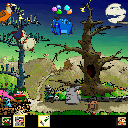
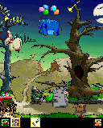
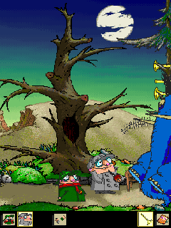

# Финальная лесная поляна — 0.22.0

Перенесена последняя игровая локация: секция 19 закреплённого PILOTS.EXE,
сцена 17 J2ME. После принятого полёта выполняется переход 16 → 17.
В подменю «Локации» добавлен «Финал: лесная поляна». Канализация остаётся
исключённой; переход в несуществующую следующую игровую комнату не выполняется.

## Объекты, анимации и исходные позиции

Из оригинала извлечены 49 используемых определений объектов, 484 правила,
59 карт, 117 общих и местных клипов (1734 кадра). Их байткод, палитры, пиксели
и опорные точки сохранены. Два исходных контроллера двуязычных подсказок
заменены подписями J2ME; контроллер 13, управляющий занятостью сцены, сохранён.

Главные действующие объекты:

| ID | Назначение |
| --- | --- |
| 24 / 25 | Коллега / Шеф |
| 26 | Слон |
| 27 / 28 | Уроненная / установленная табуретка |
| 29 / 30 | Веточка / дупло |
| 31 | Ствол, затем лесенка из флейт |
| 32 / 33 | Гордая Птица / слуга |
| 34–37 | Флейты до и после перемещения |
| 38–42 | Контроллеры переходов между уровнями дерева |
| 44–49 | Рука, табуретка и флейты в инвентаре |
| 50 | Совместная завершающая последовательность |

Также перенесены 34 исходные записи 97: отдельные рисунки и анимации,
которые выводятся командами карт, а не принадлежат объектам. Они включают
маски дерева, флейты на стволе, подъём Шефа и совместные финальные кадры.
PC-курсор из этих записей заменён существующим курсором J2ME.
Отдельные изображения сохраняют авторские координаты и слой, временные
анимации завершаются, повторное изображение на той же позиции заменяется.

Список предпросмотра очищен: только 44 многокадровых анимации финальной
локации. Для кадров подъёмов и финала заданы их фактические опорные точки.
Ресурсы предыдущих игровых локаций сохраняются.

## Перемещение и взаимодействия

Герои этой секции представлены подвижными клеточными объектами, а не
стандартной парой объектов 11/12. Сохранены исходные состояния высоты,
обход препятствий и диагональные шаги на дереве. На J2ME достаточно указать
точку и нажать 5: движение продолжается до цели вместо удержания кнопки
мыши оригинала. Невозможный маршрут завершается без блокировки управления.
Нажатие на предмет не превращается одновременно в движение к пустой клетке
под его изображением.

В VM добавлены исходная запись одного байта и корректные чтение/запись
32-битных значений по невыровненным адресам. Это необходимо для соседних
упакованных флагов дерева, флейт, слуги и финальной сцены. Изменения режима
клеток, ожидания шага и направление проходят через исходные правила.

Сохранены обе ветки действий персонажей, применение табуретки, подъёмы и
спуски, реакция птицы, освобождение слуги, дупло, все флейты, сборка лесенки,
последняя флейта и исходный финал со слоном. В нижней строке доступны
персонажи, рука, табуретка и четыре флейты; предметы также выбираются через #.
Обычная подпись персонажа скрывается на время катсцен.

В завершающей сцене камера один раз переводится к совместному кадру героев.
После исходного завершения показывается «Дело раскрыто. Игра пройдена!».
Клавиша 0 по-прежнему открывает меню.

## Звук и сохранения

Добавлены 47 WAV без изменения PCM и два исходных MIDI: 107,29 с (9857
событий) и 29,36 с (3160 событий). Смена музыки и звуковые события выполняются
исходными сценариями; после загрузки посреди финала выбирается второй трек.
Общий выключатель звука и пауза работают как в предыдущих локациях.

HWS1 сцены 17 сохраняет клеточные режимы, шаги, направления, отложенное
нажатие, движение к точке, упакованные глобальные флаги и отдельные изображения.
Сохранения прежних локаций используют прежний формат.

## Проверки

- FinalWorldTest проходит всю головоломку обычными действиями, без установки
  флагов решения. На каждом из 1479 тактов состояние сравнивается с копией,
  восстановленной из сохранения. Проверяются звуки, отдельные анимации и финал.
- FinalRenderTest проходит тот же путь через настоящие непрозрачные хотспоты
  HotelScene, проверяет подписи, отсутствие дубликатов героев и пять слотов
  предметов; сохраняет промежуточные и завершающие изображения.
- FinalAssetsTest независимо сверяет 117 клипов, все пиксели и опорные точки,
  правила, карты и 34 записи отдельных изображений с оригинальным EXE.
- LocationEntryTest проверяет подменю, переход из полёта, настоящий загрузчик,
  сохранение/продолжение движения и новый список предпросмотра.
- Общая сборка выполняет проверки предыдущих локаций, звука, декодирования,
  графических границ и CLDC preverification для трёх профилей.

Полная сборка трёх профилей прошла. CRC и размеры JAD проверены. В каждом
архиве 2095 прежних ресурсов совпадают с 0.21.3. Изменены код и каталог
локаций, старый список предпросмотра полёта заменён новым; игровые медиа
прежних сцен сохранены. Отчёты: `j2me/analysis/final-assets-audit.json`
и `j2me/analysis/final-release-audit.json`.

Это автоматические проверки на JVM; проверка новой локации на устройствах
остаётся следующим этапом.

