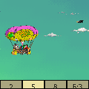
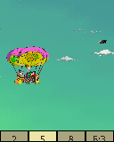
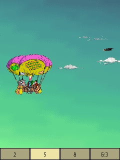

# Полёт на воздушном шаре — 0.21.0

После крыши перенесена сцена полёта: секция 18 `PILOTS.EXE`, сцена 16
движка J2ME. Переход выполняется после исходной анимации отлёта с крыши.
В подменю «Локации» добавлен «Полёт». Канализация остаётся исключённой.

## Статичный фон и размер персонажей

Для 128×128, 128×160 и 240×320 создаются отдельные центральные вырезки
оригинального неба, без масштабирования исходных пикселей. Высота вырезки
равна высоте экрана за вычетом нижней строки управления. Фон неподвижен:
курсор, масштабирование и выбор высоты не сдвигают его.

Анимации рисуются отдельно от фона. Все исходные 640 пикселей ширины
пролёта помещаются на экран, а вертикальная область с персонажами
центрируется на небе. Ширина шара составляет около 38% ширины экрана:
справа остаётся место для приближающейся вороны. Опорные точки, пропорции,
пиксели и последовательности кадров спрайтов сохранены. Движение создают
исходные анимации облаков и вороны; фон не прокручивается.

Это отдельное представление сцены, а не изменение масштаба прочих комнат.
Предпросмотр анимаций полёта использует ту же неподвижную камеру.

## Объекты → анимации → позиции

Восстановлены 33 определения объектов, 120 правил, 25 исходных карт,
группа и случайный выбор полосы появления вороны. Контроллер 11 отвечает
за двуязычную подсказку; вместо него используются управление и справка
J2ME. Контроллер 13 с игровыми правилами сохранён.

| Объект | ID оригинала |
| --- | --- |
| Инициализация сцены | 12 |
| Шар с обоими братьями и его реакции | 13 |
| Сбрасываемый балласт | 14 |
| Нижняя / средняя / верхняя область управления | 15 / 16 / 17 |
| Ворона | 18 |
| Появление вороны, полоса и такт пролёта | 19 |
| Выбранная полоса | 20–22 |
| Основной цикл облаков | 23 |
| Дополнительные облака | 24–27 |
| Контроллеры облаков и фоновых событий | 28 / 29 / 32 |
| Исходные передние эффекты | 30 / 31 / 33 |

Добавлен 71 общий и местный клип, 1591 кадр. Изображения и опорные точки
извлечены из оригинала. У трёх завершающих клипов сохранены короткие
пустые кадры и их длительность; хвостовое выравнивание исходных записей
не считается дополнительными пикселями.

Список проверки очищен: только 23 многокадровые анимации полёта.
Игровые ресурсы предыдущих локаций сохранены.

## Взаимодействия и управление

Клавиши повторяют три области нажатия оригинала:

- `2` — верхняя высота;
- `5` — средняя высота;
- `8` — нижняя высота;
- `0` или экранная команда меню — меню.

В нижней строке показаны три кнопки, текущая высота и счётчик балласта
`Б:…`. Удержание клавиши не повторяет команду после окончания анимации.
Сенсорное управление выбирает высоту нажатием на соответствующую кнопку
или на верхнюю, среднюю либо нижнюю треть сцены.

Начальная высота — средняя, запас балласта — 3. Изменение высоты, расход
балласта, последний мешок, фоновые события, выбор полосы вороны и условия
встречи с ней выполняются исходным байткодом. Сохранены три исходных
варианта завершающей последовательности. Решение не заменено таймером
или автоматическим переходом.

Следующая сцена 17 пока не включена. После завершения исходного эпизода
показывается «Полёт завершён»; возвращаемая поза шара удаляется, чтобы
после завершающей анимации он не появлялся заново.

## Звук и сохранения

Добавлены 28 WAV с исходными PCM-сэмплами и MIDI длительностью 109,70 секунды
(8522 события). Звуки вороны, балласта, реакций и фоновых событий запускаются
исходными сценариями и подчиняются общему переключателю звука.

Сохраняются высота, балласт, полоса и такт вороны, анимации, генератор
случайных чисел, локальные переменные контроллеров и фаза облаков.
Используется HWS1 с банком исходных глобальных переменных сцены 16.
Сохранения прежних локаций поддерживаются.

## Проверки

- `FlightWorldTest`: три высоты, исходный расход балласта, три варианта
  встречи с вороной и завершения. После каждого такта снимок сравнивается
  с копией, заново восстановленной из сохранения — 791 проверка.
- `FlightRenderTest`: неподвижный фон независимо от курсора и увеличения,
  шар меньше 40% ширины экрана, видимая ворона справа с запасом более
  четверти ширины до шара, исходный завершающий эпизод.
- `FlightAssetsTest.py`: независимая сверка всех пикселей, опорных точек,
  определений, правил, карт и вырезок фона с оригинальным EXE.
- `LocationEntryTest`: переход с крыши, прямой запуск через подменю,
  настоящие кнопки Canvas, меню и RMS-восстановление высоты, балласта
  и текущей фазы анимации. Общая сборка проверяет прежние локации,
  звук, декодирование кадров и CLDC preverification.

Полная сборка трёх профилей прошла. CRC архивов и размеры из JAD проверены.
1991 прежний ресурс каждого профиля побайтово совпадает с 0.20.1; изменён
каталог локаций, а список предпросмотра крыши заменён списком полёта.
Отчёты: `j2me/analysis/flight-assets-audit.json` и `flight-release-audit.json`.

Это проверки на JVM; следующая проверка — на устройствах.

