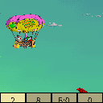
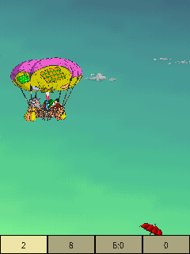
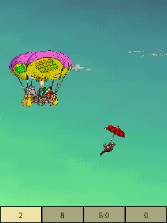

# Появление кота снизу — 0.21.3

Повторное появление кота на зонтике (клип 72) начиналось на нижней границе
оригинальной сцены y=417. При уменьшении игрового поля эта граница оказалась
внутри экрана телефона. Первые восемь исходных кадров также уже обрезаны
по ней в ресурсах ПК.

Для кадров 0–7 используется первая целая поза этого же оригинального клипа
(кадр 8) с исходными координатами движения. FlightView начинает показ за
фактической нижней границей игровой области телефона и постепенно сводит
смещение к нулю к кадру 8. Дальше продолжается принятая траектория.
Первый кадр полностью скрыт; следующие показываются постепенно снизу.
Это работает и в игре, и в предпросмотре анимации, независимо от разрешения.

Изменены только изображение клипа 72 и его отображение при входе.
Длительность, правила повторного появления, музыка, звуки, управление,
продлённый уход вниз и остальные спрайты сохранены. Формат HWS1 прежний:
положение при входе вычисляется из сохранённого номера кадра и размера экрана.

FlightRenderTest сравнивает настоящий рисунок сцены с включённым и скрытым
котом: кадр 0 невидим, кадр 1 касается нижнего ряда пикселей, кадр 8 целиком
появляется в игровой области. Проверяется также побайтово одинаковый рисунок
после восстановления сохранения посреди входа. FlightAssetsTest сверяет
новые кадры с целой оригинальной позой, остальные кадры — с прежней адаптацией.

Полная сборка 128×128, 128×160 и 240×320 прошла. CRC и размеры JAD проверены.
2165 записей каждого JAR побайтово совпадают с 0.21.2. Изменены FlightView,
клип 72, его начальная точка предпросмотра и версия манифеста; список из
23 анимаций сохранён. Отчёт: `j2me/analysis/flight-cat-entry-release-audit.json`.

