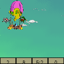
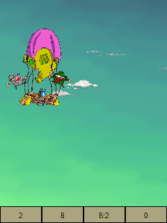
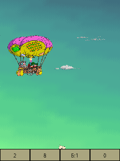

# Управление и края анимаций полёта — 0.21.2

Кнопки 2 / вверх и 8 / вниз теперь задают направление изменения высоты.
Каждое действие переводит шар на соседнюю высоту исходной механики;
удержание продолжает движение после завершения текущей реакции.
Кнопка 5 больше не выбирает среднюю высоту. На верхнем и нижнем пределах
повторное направление ничего не расходует. Сенсорное управление использует
верхнюю/нижнюю половины сцены и две кнопки в нижней строке. Остальные
ячейки показывают балласт и возврат в меню. Справка обновлена.

Верхняя часть шара в кадрах 3–16 верхнего падения была обрезана по границе
экрана ПК ещё в оригинальных ресурсах. Недостающие строки восстановлены
из соответствующих кадров среднего варианта со смещением на 96 пикселей.
Видимая часть исходного верхнего кадра сохранена целиком. Продлённое падение
из 0.21.1 сохраняется.

Холодильник и два варианта полёта кота больше не заканчиваются обрезанными
кадрами на исходной границе y=417. После последнего целого кадра исходная
поза продолжает падать с ускорением. Траектории доведены за нижнюю границу
всех трёх профилей. Вариант ухода кота за левый край сохранён.

Изменены только клипы 57, 64, 70 и 72 сцены 16. Общее число клипов прежнее,
1513; число кадров — 18678. Правила, карты и исходные звуковые события
сохранены; в таблице VM обновлена только длительность трёх продлённых клипов.
Номер кадра и положение по-прежнему восстанавливаются из HWS1 без нового
формата сохранений.

Проверки: FlightRenderTest использует настоящую сцену, проверяет относительное
управление, пределы высоты, расход балласта, три падения, восстановленный верх
и уход холодильника/кота за нижний край каждого профиля. FlightAssetsTest
независимо сверяет изменённые кадры с пикселями оригинала, остальные ресурсы,
правила и карты — с исходным EXE.

Полная сборка трёх профилей прошла. CRC и размеры JAD проверены. В каждом
архиве 2158 записей совпадают с 0.21.1; изменены пять классов управления
и отображения, четыре клипа, таблица длительностей VM и версия манифеста.
Отчёт: `j2me/analysis/flight-controls-release-audit.json`.

