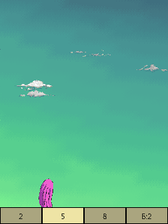

# Падение в полёте — 0.21.1

После уменьшения сцены исходная нижняя граница 417 оказалась внутри экрана телефона.
Последние кадры трёх вариантов падения уже обрезаны по этой границе в оригинале.

Теперь после кадра 17 сохраняется целая исходная поза и продолжает двигаться
вниз на 48 исходных пикселей за такт. Вместо пустого хвоста катсцены виден
продолженный полёт вниз, до полного ухода персонажей за нижний край.
Масштаб и неподвижное небо сохраняются. Байткод, звук и время завершения
не изменены; положение восстанавливается из сохранённых клипа и номера кадра.

FlightRenderTest проверяет все три варианта падения на каждом разрешении:
непрерывное движение вниз, целую позу, не менее 15 дополнительных тактов
и полный уход за нижнюю границу. Полная сборка проверяет прежние локации,
сохранения, исходные ресурсы, звук и CLDC.

Полная сборка трёх профилей прошла. CRC и JAD проверены. В каждом JAR
2167 записей побайтово совпадают с 0.21.0; изменены только FlightScene.class
и версия в манифесте. Отчёт: j2me/analysis/flight-fall-release-audit.json.
