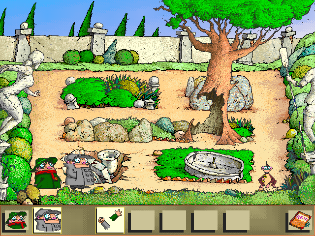
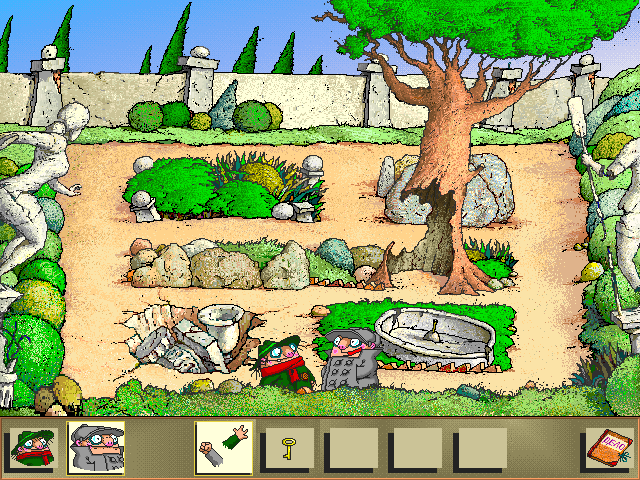

# Четвёртая локация — сад с мартышкой, 0.10.0

После звериного двора открывается сад. В меню добавлена «Четвёртая локация»
для отдельной проверки. Пятая игровая локация этой сборкой не добавлена.
Внутренний номер сада — 05, источник — секция 7 закреплённого `PILOTS.EXE`.

## Объекты → анимации → позиции

[Извлечение](../j2me/extract_garden.py) сохраняет определения объектов,
начальную карту, карты изменений, предикаты и тела исходных правил.
[Опись оригинала](../j2me/analysis/garden-original-rules.json) содержит
смещения записей, байткоды и контрольную сумму EXE.
В VM упакованы 29 общих/локальных определений и 155 правил. Два контроллера
оконного текста заменены субтитром J2ME; их исходные записи сохранены в описи.

| Объект | Назначение | Начальная опора |
| --- | --- | --- |
| 11 | Шеф | 128,368 |
| 12 | Коллега | 64,368 |
| 14 | Мартышка с ключом | 512,368 |
| 15 | Динамические проходы сада | служебный контроллер |
| 16 | Открытый проход | создаётся исходными картами |
| 17–26 | Декорации и передние планы | из начальной карты |
| 27 | Состояние поимки и завершение | служебный контроллер |
| 30 | Ключ в нижней строке | появляется после поимки |

Перенесены 40 местных клипов, общие позы и ходьба персонажей. Всего добавлены
84 ANM с 726 кадрами; в игре теперь 389 клипов / 4545 кадров.
Палитра, пиксели, точки привязки кадров и слои происходят из оригинала.
Мартышка перемещается между опорами с интерполяцией по четырём кадрам ходьбы
и возвращается к основной позе между шагами.

Список проверки очищен: в «Анимациях» только **25 анимаций сада**, номера
01–25. В подписи также указан родной номер клипа. Старые списки 02–04
удалены из JAR, игровые ресурсы прежних локаций сохранены.
Предпросмотр не переносит снимок другой локации в VM сада; возврат
восстанавливает сохранённое состояние игры.

Для 128x128 и 128x160 используется проверенный исходный фон шириной
320 пикселей при мировых координатах 640x417, как у предыдущих сцен.
Для 240x320 — фон 640x417. Нижняя строка использует родную палитру сада.

## Взаимодействия

`GardenWorld` выполняет исходные условия подходов Шефа и Коллеги,
реакции на близость мартышки, переключения проходов, поимку, движение
к финальным позициям и сцену с ключом. В запросах карты сохранена группа 0
из оригинала — Шеф и Коллега; она используется предикатами проходов.
Движущаяся мартышка обновляет не только изображение, но и свою клетку карты.
Шеф при исходном захвате удаляет мартышку из этой клетки.

Обычные перемещения братьев адаптированы к сетке J2ME 16x16 с BFS,
обработкой препятствий и исходными опорами. Нативный Windows-поиск пути
не перенесён побитово. Выбор отхода мартышки также реализован адаптером:
среди разрешённых исходной картой соседей выбирается уход дальше от
ближайшего брата. Проходы определяет оригинальный контроллер 15.
Это место важно отдельно проверить на телефоне при разных расстановках
братьев: исходные сценарные условия сохранены, нативная навигация заменена.

Реакции идут по исходным счётчикам. Для ветки Коллеги 8 добавлено
освобождение управления на отметке 6: в исходной записи 12.27 проверяется
действие 6, хотя предыдущие правила этой ветки запускают 8. Без адаптации
J2ME оставался в занятом состоянии после окончания реакции.

После поимки Шеф и Коллега сходятся к `(320,384)` и `(256,384)`.
Ключ появляется в нижней строке, в инвентаре подписан «Ключ».
Предметы из прежних локаций в сад не переносятся. После финальной реплики
нажмите **5**, чтобы подтвердить окончание сцены.

## Диалоги, звук и музыка

Реплика извлечена из русских текстов контроллеров 28/29:
«Или это ключ от номера Карбофоса… или одно из двух».
Она показывается при исходном звуковом событии 21 и сохраняется вместе
с оставшимся временем показа. Оконный вывод оригинала заменён верхней
строкой субтитров.

Добавлены 25 WAV и MIDI сада: в сборке теперь 150 WAV и четыре MIDI.
PCM сохраняется без потерь; MIDI сохраняет исходные события и их время.
Пауза, возобновление, выключение звука и освобождение проигрывателей
используют существующий общий аудиодвижок.

## Сохранения и проверки

Для сада используется GWS1 внутри общей оболочки PSV2. Записываются карта,
герои, состояния контроллеров, исходные переменные, текущие кадры,
основные позы, интерполяция мартышки, маршрут и субтитр. Старые форматы
предыдущих локаций продолжают читаться. Старые версии игры не знают сад.

`GardenWorldTest` проходит погоню и поимку, проверяет ключ, реплику, звук,
подтверждение, финальные позиции и повторяет каждый тик через сохранение
и загрузку. Проверяются также неверные подходы Коллеги и отсутствие пропажи
мартышки до захвата. `GardenRenderTest` использует настоящие клики сцены,
производственную отрисовку и панель для каждого размера экрана.

Общая сборка дополнительно выполняет прежние сценарии трёх локаций,
проверки звука, всех 4545 кадров, RGB, прокрутки и независимости профилей.
Проверки выполнены на настольной JVM. На устройствах новую локацию
ещё нужно проверить.
