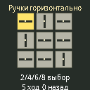
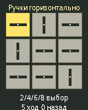
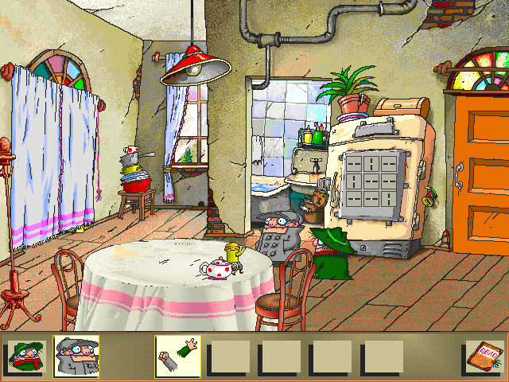

# Холодильник 3×3 и сценарий ванной — 0.13.0

Головоломка холодильника адаптирована для маленьких экранов по предложению
пользователя: на двери и в отдельном увеличенном окне теперь девять ручек.
Исходное правило поворота строки и столбца сохранено. Канализация по-прежнему
пропускается; следующие игровые локации в этой версии не добавлены.

## Отдельный экран

Выберите Шефа и руку (без предмета) в нижней панели. При выборе панели
холодильника Шеф подходит к ней и выполняет исходную
анимацию ручки. Затем открывается отдельный `FridgeCanvas`. На нём видна вся
матрица 3×3, без прокрутки; выбранная ручка выделена жёлтым.

| Управление | Действие |
| --- | --- |
| 2 / 4 / 6 / 8 или стрелки | Выбрать ручку |
| 5 или Fire | Повернуть выбранную строку и столбец |
| Касание ручки | Выбрать и повернуть |
| 0 или «Назад» | Вернуться в комнату |

Цель — расположить все ручки горизонтально. Поворот затрагивает каждую ручку
выбранных строки и столбца один раз, включая их пересечение. Удержание Fire
не вызывает повторных случайных ходов. После настройки нужно вернуться в
комнату и воспользоваться ручкой холодильника; ключ и финальная сцена
остаются частью игрового сценария.

Начальное положение получается последовательностью допустимых ходов из
решённого состояния. Это важно для матрицы 3×3: случайный набор девяти
ориентаций не всегда имеет решение при таком правиле. Начальная комбинация
не является решённой, кроме переноса уже решённого холодильника из старого
сохранения.

Комната и её таймеры приостанавливаются на время увеличенного экрана.
Положение ручек сохраняется при выходе и в обычном сохранении игры.
Загрузка сохранения, записанного с открытой панелью, возвращает этот экран.
При возвращении в комнату на двери отображается та же комбинация 3×3.
Оригинальные 16 областей переключения отключены для ввода и отрисовки.

## Ключ, полотенце и крокодил

Исправлено преждевременное взятие ключа. Правильная последовательность:

1. Шеф берёт баллончик.
2. Коллега применяет баллончик возле полотенца в ванной. Проигрывается исходная
   анимация, полотенце убирается, появляется крокодил.
3. Шеф применяет баллончик к крокодилу.
4. Пока крокодил отступил, Коллега берёт ключ.

До удаления полотенца ключ нельзя ни выбрать через перекрывающий его объект,
ни получить прямым вызовом взаимодействия. При активном крокодиле ключ также
недоступен. После его отступления действует исходное окно в 100 тактов
сценария; часть этого времени занимает анимация Шефа. Если промедлить,
крокодил возвращается, и его нужно отогнать повторно.

Условия проверяются и при выборе ключа, и после подхода персонажа. Поэтому
нажатие в конце временного окна не позволяет обойти возвращение крокодила.

## Графические исправления

- Поиск области действия учитывает непрозрачные пиксели перекрывающих
  объектов, включая неинтерактивное полотенце. Невидимый предмет за ними
  больше не перехватывает нажатие.
- После окончания действия оба персонажа получают целую позу ожидания;
  фрагмент промежуточного кадра больше не остаётся до следующего действия.
- Завершение исходного шага ходьбы входит в состояние занятости. Новое
  действие не прерывает последний шаг подхода.
- Ручная ходьба использует общую плоскость комнаты и исходный шаг изменения
  глубины — два слоя на клетку по вертикали. После вступления глубина Коллеги
  приводится к этой плоскости.
- Абсолютная перестановка персонажа очищает старую интерполяцию ходьбы,
  чтобы спрайт не рисовался между прежней и новой позициями.
- Первый сценарий крокодила выполняется в момент его создания, до перехода
  контроллера ванной к следующему шагу. Это восстанавливает его видимую позу
  и доступную область взаимодействия.

## Сохранения и связь с оригиналом

Сохраняются контейнер `PSV2` и снимок гостиницы `HWS1`. В резервных переменных
добавлены положение девяти ручек, состояние увеличенного окна и метка `FR31`.
Читатель принимает сохранения 0.12.0, переносит комнату и инвентарь и создаёт
решаемую комбинацию 3×3, исправляет плоскость персонажей. Уже собранные предметы старого сохранения не отнимаются.

Сценарии ключа, ванной, исходные анимации действий и финал холодильника
исполняются из прежнего байткода. Новый адаптер передаёт результат матрицы
исходному условию победы, сохраняя проверку замка. Служебные объекты старой
матрицы остаются внутренней частью интерпретатора; игрок видит и использует
только девять ручек.

## Проверки

`HotelWorldTest` проверяет запрет раннего взятия, появление и возвращение
крокодила, повторное отпугивание, подбор ключа в допустимое время, девять
переключателей, решение и финал. После каждого шага выполняется сравнение
с восстановленной копией сохранения. Проверяется миграция настоящего
сохранения 0.12.0 из `tests/fixtures/hotel-0.12.0-room.psv`.

`HotelRenderTest` проходит взаимодействия через реальные видимые пиксели,
проверяет отсутствие выбора ключа через полотенце и снимает оба экрана.
`LocationEntryTest` проверяет открытие отдельного Canvas, клавиатурный выбор,
возврат, запись RMS и повторное открытие после загрузки.

Примеры отрисовки, полученные настольными проверками:

Проверки на JVM и CLDC preverification не заменяют испытания на телефонах.
