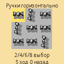
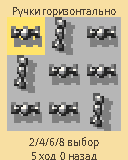
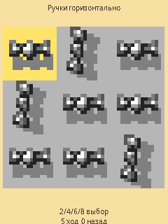
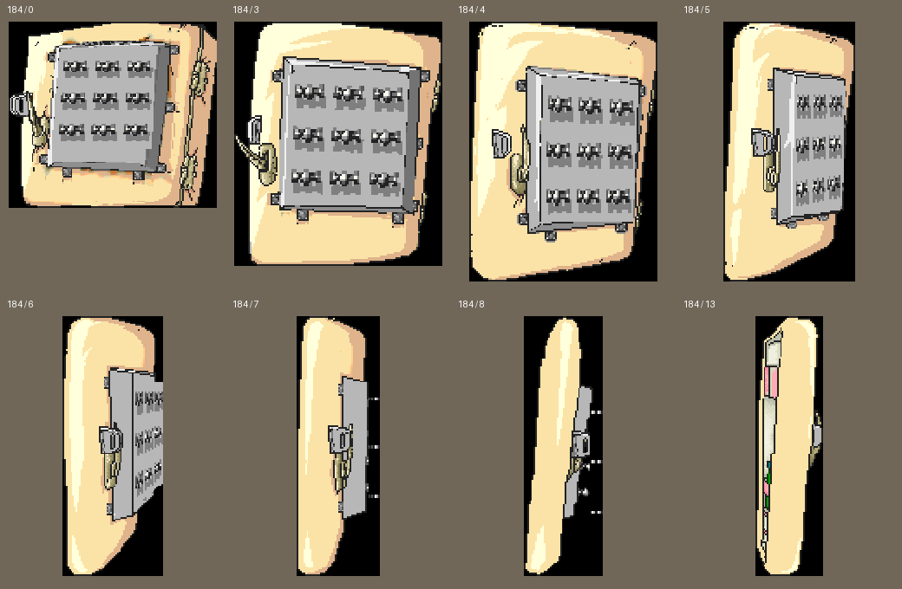
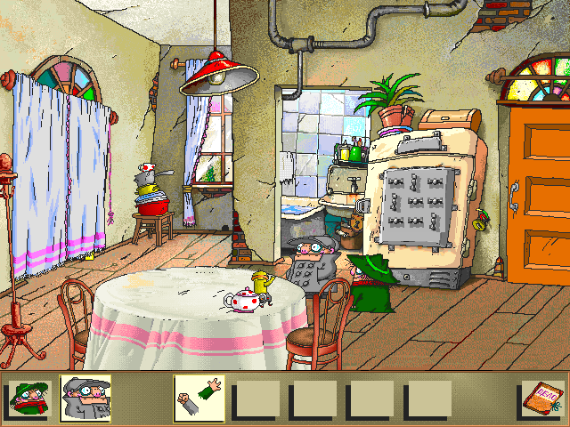

# Холодильник: отрисовка, оригинальные ручки и возврат — 0.13.1

Исправления после проверки версии 0.13.0 на устройствах. Новых локаций нет;
матрица остаётся 3×3, правила ходов и последовательность ванной сохранены.

## Перекрытия персонажей

Для декоративных накладок двери, стены возле выключателя, перегородки ванной
и шторы слева плоскость перекрытия теперь определяется по нижнему краю
спрайта. Учитывается, что исходная точка персонажа находится на 16 пикселей
выше его ступней. Персонаж, уже вышедший перед перегородкой, больше не должен
терять голову за её накладкой. Предметы переднего плана — стол и стулья —
сохраняют свои слои.

Висящий замок и ручка относятся к поверхности холодильника, как и новая
матрица. Они больше не рисуются поверх проходящих перед холодильником
персонажей. Выключатель также отнесён к плоскости стены, на которой закреплён.
Матрица рисуется непосредственно после корпуса холодильника, чтобы не
перекрывать реакцию персонажа с совпадающей глубиной. Определение объекта под курсором использует тот же порядок,
что и отрисовка. Если персонаж закрывает ручку, можно нажать на видимую
панель с девятью переключателями: она запускает то же действие холодильника.

Сценарные координаты, сохранённая глубина персонажей и формат сохранений
при этом не меняются: исправляется представление объектов в `HotelScene`.

## Отдельный экран

Горизонтальные и вертикальные ручки теперь берутся из оригинальных анимаций
116 и 132. На двери и в увеличенном окне используется один способ отрисовки;
масштабирование сохраняет исходные пиксели, прозрачность и тени. Рамки
вокруг каждой ручки убраны. Выбранная ячейка остаётся жёлтой. Цвета отдельного
экрана соответствуют светлому корпусу холодильника и металлической панели.

После последнего успешного хода экран закрывается автоматически. Игрок
возвращается в комнату; её сценарий и таймеры возобновляются. Это работает
при управлении клавишей 5/Fire и касанием. Повторное событие уже закрытого
экрана не делает ход и не вызывает второй возврат. Клавиша 0 / «Назад»
по-прежнему позволяет прервать решение с сохранением комбинации.

После решения для открывания холодильника выберите его панель или ручку
Шефом без предмета. Исходная проверка снятого замка сохраняется.

## Анимация открывания

В исходном клипе 184 часть кадров содержит нарисованную матрицу 4×4.
Сборочный адаптер `j2me/adapt_fridge.py` заменяет её на девять оригинальных
горизонтальных ручек, учитывая перспективу движущейся двери. В начальных
кадрах ручки также остаются на двери, а при повороте боком видны три ряда
выступающих концов вместо четырёх.

Сохраняются все 14 кадров, их размеры, точки привязки, длительность,
палитра и прозрачность. Вне заданных областей панели и выступов пиксели
сохранены. Кадры 9, 10 и 13 остаются целиком исходными. Другие клипы,
сценарный байткод, музыка и звуки не менялись. Адаптер выполняется до
обычного сжатия ANM3, отдельно для каждой сборки; на телефоне не требуется
перерисовывать или преобразовывать кадры анимации.

Границы правок и контрольные суммы исходного и полученного клипа записаны
в `j2me/analysis/hotel-09-original-rules.json`, поле
`fridge_door_adaptation`.

## Проверки

- `HotelRenderTest`: перекрытия головы в четырёх позициях возле стен и
  замка, включая временное изменение глубины при реакции; ввод через видимые объекты, прохождение ванной и холодильника,
  автоматический возврат клавиатурой и касанием, защита от повторного ввода.
- `LocationEntryTest`: реальный переход между Canvas в MIDlet после решения,
  сохранение RMS и повторное открытие незавершённой головоломки.
- `FridgeAssetsTest`: изменён только клип 184; заголовки и привязки всех
  кадров сохранены; в движущейся панели три ряда по три ручки.
- Полная сборка и CLDC preverification трёх профилей; регрессионные проверки
  предыдущих локаций, сохранений, звука, декодирования и отрисовки.

Это настольные проверки. Версия 0.13.1 ещё требует проверки на телефонах.

