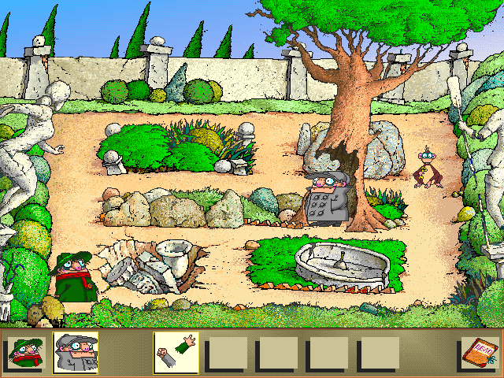
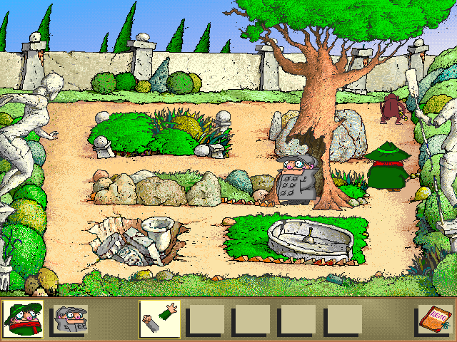

# Погоня за мартышкой и засада у дерева, 0.10.2

В 0.10.0–0.10.1 мартышка выбирала соседнюю клетку по расстоянию до братьев.
Это обходило маршрутизацию оригинала: она не реагировала на предусмотренные
позиции героев и могла сблизиться с преследователем. Кроме того, ходьба братьев
шла по сетке 16×16 при исходной карте 64×16, из-за чего проверка точного
положения персонажа срабатывала лишь на части шагов.

## Исходная логика и исправление

У правила 14.5 вызов `native 24` имеет **два аргумента**: целевой объект 16
и режим 2. Это видно в байткоде секции 7:
`1d10000000211d0200000021362400000000`.
В [декомпиляции](../reverse-engineering/generated/PILOTS.EXE/decompiled.c)
цепочка `0040844c → 0040803c → 00407f04 → 00407e10` строит путь по пустым
клеткам к клетке указанного типа. `0040860c` проверяет направление следующего
шага. Прежний адаптер читал только последний аргумент и подменял этот поиск.

Теперь мартышка ищет путь к открытым клеткам объекта 16. Их размещение
по-прежнему задают исходные правила контроллера 15 и карты 0–39, учитывающие
позиции братьев. Занятые героями клетки и декорации закрыты для этого поиска.
Следующий шаг начинается после четырёх кадров предыдущего, а не по независимому
таймеру. Между шагами остаётся исходная поза 46.

Для J2ME используется BFS с повторно используемой очередью на 300 клеток.
Это сохраняет назначение исходного вызова и условия проходимости, но выбор
между равноудалёнными маршрутами не заявляется побитовой копией Windows-движка.
Радиус реакции не задан отдельной произвольной константой: направление отхода
определяется исходными зонами и проходами, заранее переключаемыми братьями.

Шеф может ждать у дерева: **384,272**, исходная карта 41. Коллега гонит
мартышку по дорожкам; когда она пробегает через **384,288**, срабатывает
исходное действие 12, затем сцена с ключом и заключительной репликой.
Захват не заменён автоматическим завершением при приближении к дереву.

## Ходьба и графические наложения

Братья перемещаются по опорам исходной карты 64×16. Каждый шаг занимает
пять кадров, а отрисовка плавно интерполирует положение между опорами.
Логическая позиция остаётся пригодной для исходных предикатов карты.
Путь учитывает занятую вторым братом клетку.

Глубина восстановлена от исходного значения 6 на строке 368, с изменением
на 3 при переходе на соседнюю строку. Убрано дополнительное смещение слоя.
Это исправляет неверное перекрытие героев камнями, статуями и частями дерева.
Сами изображения, палитры и исходные слои декораций не изменены.

## Сохранения и проверки

Новые снимки сада имеют маркер GWS2 внутри PSV2. Читатель принимает также
GWS1 из 0.10.0–0.10.1: старые физические позиции приводятся к ближайшим
доступным опорам, путь перестраивается, переменные головоломки сохраняются.
Старый незавершённый шаг может немного изменить положение после загрузки.
Сохранения первых трёх локаций используют прежние форматы.

`GardenWorldTest` проходит сценарий через дерево и погоню Коллегой, проверяет
раннее начало отхода, отсутствие встречного движения рядом с Коллегой,
прохождение верхней дорожки, исходное действие захвата, ключ, реплику,
подтверждение завершения и восстановление снимка после каждого тика.
Отдельный настоящий снимок 0.10.1 проверяет перенос незавершённой ходьбы.
`GardenRenderTest` проходит этот же сценарий через входные запросы сцены,
проверяет глубину и промежуточную позицию ходьбы, сохраняет изображения.

Эти проверки включены в сборку всех профилей вместе с тестом входа через
настоящий `GameCanvas`, прежними игровыми, графическими и звуковыми тестами.
Проверка на телефоне остаётся за устройством: настольные тесты не измеряют
работу конкретной реализации MIDP.

Полная сборка и проверки прошли для 128×128, 128×160 и 240×320.
На опубликованном JAR 0.10.1 новый тест воспроизводит ошибку
`monkey ran into a hero`; на 0.10.2 проходит. Сравнение содержимого JAR
подтвердило: изменены только `GardenWorld`, `GardenScene` и версия манифеста,
все игровые ресурсы совпадают побайтно.
