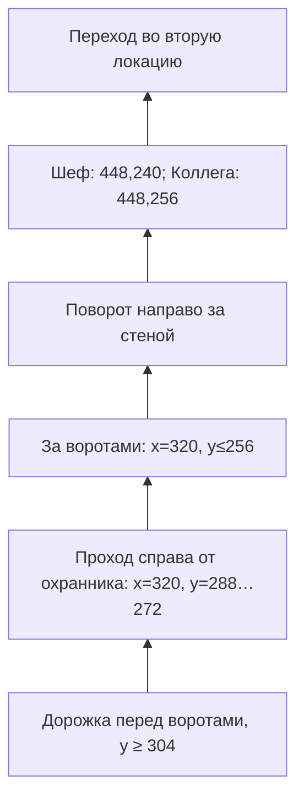

# Оплата и выход через ворота — 0.9.2

Сборки: [128×128](../j2me/dist/Pilots-128x128.jar),
[128×160 — Nokia C1-02](../j2me/dist/Pilots-128x160.jar),
[240×320](../j2me/dist/Pilots-240x320.jar).

После вручения монеты охраннику она оставалась в инвентаре. Путь обоих
героев к точкам выхода разрешал пересечь стену справа от ворот.

Монета теперь расходуется при завершении передачи Шефом, на счётчике 12
действия 30. Выбор предмета возвращается к руке; чайник и кирка остаются.
Неудачная попытка оплатить без охранника не расходует монету. Загрузка
старого сохранения после передачи или открытия ворот также убирает
оставшуюся монету. Формат сохранений не менялся.

Карта 83 оригинальной секции 4 очищает клетку (5,18), то есть (320,288),
которая до оплаты заблокирована. Клетки стены правее неё остаются закрытыми,
а в (384,272) и (448,272) устанавливается внутренняя преграда. Карта 84
проверяет конечные позиции Шефа (448,240) и Коллеги (448,256). Прежний граф
ошибочно разрешал полосу x=384…448 перед этими позициями, прямо через стену.

Исправленный граф пропускает героев через x=320, справа от охранника,
и разрешает идти вправо только на глубине y≤256, уже за колонной и стеной.
Корень спрайта расположен у его левого края: при x=320 ноги находятся
около середины открытого прохода. Слои персонажей при повороте остаются
за стеной и правой колонной. Конечная формация и переход во двор сохранены.

Исходная карта и граница завершения передачи (правило 17.67, счётчик 12)
проверяются извлечением из закреплённого EXE. Свидетельства добавлены в
`exit_walk_topology` отчёта `first-location-original-rules.json`.
Удаление предмета реализовано явно в адаптере инвентаря J2ME.

Регрессионная проверка проходит весь первый квест и проверяет наличие
монеты до передачи, отсутствие после неё, сохранение в середине оплаты,
исправление старого оплаченного сохранения и сохранность других предметов.
Для каждого героя отслеживается проход через ворота до поворота вправо,
слой за стеной и итоговая позиция. Во время выхода состояние регулярно
сохраняется и восстанавливается, чтобы проверить возобновление маршрута.
Проверки выполняются для всех трёх профилей вместе с остальными тестами
сборки. Реальный телефон в этих проверках не использовался.
