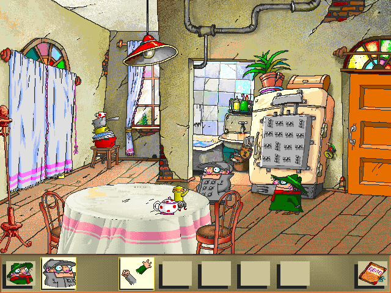
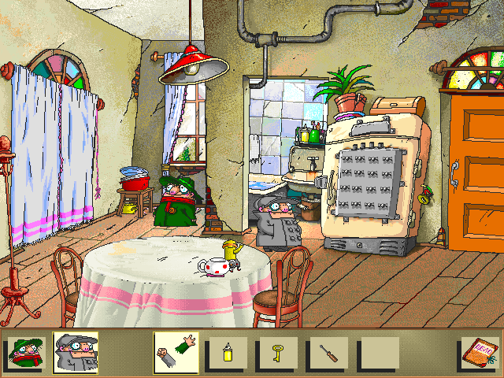

# Гостиница и пропуск канализации — 0.12.0

По решению пользователя шестая игровая локация, канализация, исключена из
J2ME-прохождения. После завершения улицы запускается оригинальная сцена перед
гостиницей, затем автоматически открывается её игровой интерьер.

## Нумерация и переходы

| Эпизод оригинала | Внутренняя сцена J2ME | Раздел EXE | Состояние |
| --- | --- | --- | --- |
| Улица, пятая локация | 06 | 8 | Сохранена, выход ведёт в 08 |
| Канализация, шестая локация | 07 | 9 | Исключена из каталога и готовых JAR |
| Вступление перед гостиницей, седьмая локация | 08 | 10 | Перенесено, автоматический переход в 09 |
| Интерьер гостиницы | 09 | 11 | Перенесён до финала головоломки |

Доступный маршрут: `02 → 03 → 04 → 05 → 06 → 08 → 09`.
После завершения интерьера игра остаётся в этой сцене: дальнейшая локация ещё
не подключена. В меню есть отдельные входы во вступление и интерьер гостиницы.

Пропуск канализации не требует выдачи предметов: исходный сценарий вступления
сам проигрывает использование ключа, а интерьер создаёт собственные предметы
и начальное состояние. Прохождение проверено со свежим состоянием, без флагов
или инвентаря шестой локации.

## Объекты → анимации → позиции → взаимодействия → диалоги

Извлечение воспроизводимо через `j2me/extract_hotel.py`; исходный EXE закреплён
SHA-256 `c980fb1ad09c3543d89dd0be26c062b8847fab73e86b92012c4fe0507ba34e1f`.
Сырые правила, координаты, группы и исходные смещения записываются в
`j2me/analysis/hotel-08-original-rules.json` и `hotel-09-original-rules.json`.

- Вступление: локальный клип 46, все 217 кадров с исходными опорными точками.
  Две реплики берутся из строк оригинального байткода, звуки привязаны к его
  шагам: 6, 63/66/69, 78, 108 и 166. Скрытие реплик — шаги 60 и 150.
- Интерьер: 90 локальных определений объектов, 167 локальных клипов и
  156 карт правил. С общими объектами выполняются 100 определений и 1199
  правил; исходный контроллер двуязычных подсказок заменён русскими подписями.
- Корни объектов, слои, перемещения по клеткам 64×16 и замены объектов
  берутся из сценария. При удалении исполняется исходный обработчик выхода;
  его отдельная анимация продолжает отрисовываться.
- Роли героев в этом разделе: объект 13 — Шеф, 12 — Коллега. Сохраняются
  разные реакции, подходы к объектам и действия при неверном применении вещи.
- Перенесены баллончик, ключ и отвёртка, ванная и её обитатель, штора, куча,
  чайник, сахарница, включатель, замок и ручка холодильника.
  Предметы появляются в нижней панели только после исходного события взятия.
- Переключатели холодильника используют исходные правила: меняются выбранная
  строка и столбец. Начальная комбинация выбирается из исходных пар объектов;
  локальный генератор воспроизводим и сохраняется вместе с состоянием.
- Финал запускается только после отпирания замка и правильного положения
  переключателей. Перенесены открытие холодильника, персонажи в финальной
  сцене, уход к выходу и смена музыкального трека.

Вступление и интерьер озвучены исходными PCM; музыка преобразуется из
оригинального потока MIDI-событий. В интерьере подключён второй музыкальный
трек, который вызывает финальный сценарий. Строки вступления сохранены с
оригинальным написанием; реплики внутри комнаты воспроизводятся из исходных
аудиозаписей. Не подтверждённые текстовые расшифровки озвучки не добавлены.

В меню проверки оставлены только 72 многокадровые анимации интерьера.
Списки прежних локаций и вступления в готовые JAR не включены. Игровые клипы
предыдущих локаций сохранены.

## Реализация и совместимость

`HotelWorld` исполняет исходные предикаты, тела правил, карты и группы.
Встроенные адреса двух строк вступления преобразуются в индексы UTF-8.
Отдельная переменная сценария по адресу `0x1e1b54` хранится в резервной
ячейке 60 состояния J2ME; большой адрес не используется как индекс массива.
Предыдущие миры и их форматы сохранения не изменены.

Снимок гостиницы `HWS1` хранится в расширении `PSV2`: объекты, герои, кадры,
отдельные эффекты, переменные, случайная комбинация, маршрут и текущий шаг. Музыкальный трек финала восстанавливается при загрузке.
Сохранение во вступлении возобновляет его с текущего кадра, без повторения уже
проигранных звуков. Версии 128×128, 128×160 и 240×320 сохраняют разные имена
приложений и прежние настройки кэша.

## Проверки

`HotelWorldTest` проверяет все кадры и обе реплики вступления, порядок звуков,
переходы с пропуском 07, действия обоих героев по начальным объектам, три
предмета, ванную, замок, все 16 переключателей, решение головоломки и финал.
После каждого шага сравнивается результат сохранённого и восстановленного
исполнения. Решение тест получает из эффектов переключателей, без выдачи
предметов или принудительного выставления флага победы.

`HotelRenderTest` проходит взятие предметов, отпирание, переключатели и финал
через реальные видимые области объектов. Снимки полного мира:

Проверки MIDlet охватывают вход из меню, переход с улицы, переход вступление →
интерьер, RMS-сохранения и возврат из просмотра анимации. Проверяются также
предыдущие пять локаций, декодирование всех кадров без потерь, границы
`drawRGB`, MMAPI и три независимых профиля установки.

Полная сборка 0.12.0 прошла проверки для всех трёх профилей: 54 класса с
CLDC preverification, 738 клипов / 8540 кадров, 251 WAV и восемь MIDI.
Дополнительно сравнивались байты игровых и звуковых ресурсов прежних пяти
локаций с 0.11.1; они не изменились, кроме удаления старого списка проверки.

Это проверки на настольной JVM. Испытание новых сцен на телефонах предстоит
пользователю; прохождение предыдущей версии им подтверждено.
