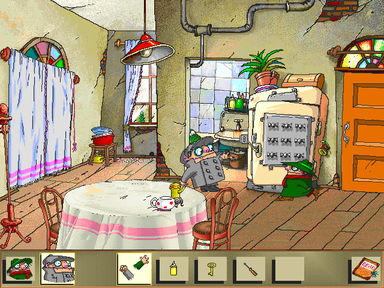
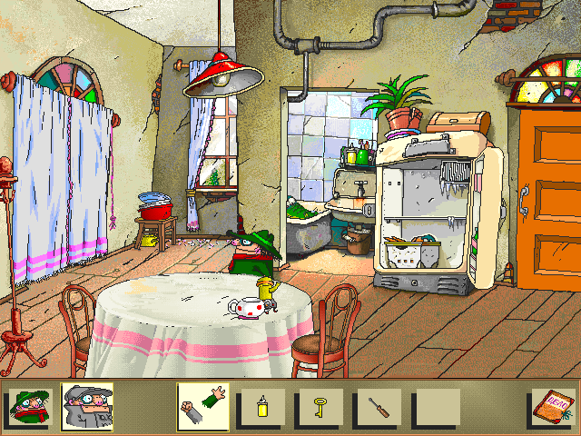

# Финал гостиницы и проход перед дверью холодильника — 0.13.3

Исправления после проверки версии 0.13.2 на устройстве. Следующая локация
не добавлена; изменения завершают текущую сцену гостиницы.

## Неподвижная поза и выход Коллеги

В оригинальном сценарии на шаге 98 действия 84 объект 97 заменяет
контроллер персонажа 12 и показывает фиксированную позу клипом 194.
Порт хранил персонажей отдельно от клеток сцены и оставлял старый
контроллер живым. В результате фиксированная поза перекрывала его
последующую анимацию.

Теперь замена на объект 97 отключает прежний контроллер в этой клетке.
Во время авторской паузы показывается только одна поза. В конце сцены
она удаляется, Коллега получает обычную позу и выходит через освободившуюся
дверь вслед за первым персонажем. Для движения используется исходный
контроллер 12 с маршрутным маркером 7 и оригинальными кадрами ходьбы.

В ПК-версии вызов `0e(10)` после выхода первого персонажа сразу меняет
сцену. В J2ME он теперь запускает завершающий проход Коллеги. Отметка
«Гостиница пройдена» устанавливается только после последнего кадра его
последнего шага. Оба персонажа к этому моменту покинули комнату; оставшейся
поверх сцены позы 97 нет.

## Открытая дверь холодильника

Исходная вступительная расстановка задаёт глубину персонажей по формуле
`54 - y/8`: у корней `(576,288)` и `(576,272)` исходные глубины равны 18
и 20. Обычная ходьба в порте ранее была нормализована к `58 - y/8`.
Сочетание этой поправки с абсолютным авторским слоем 15 у открытой двери
давало неправильное перекрытие при проходе перед ней.

В действиях 84 и 87 отрисовка персонажей возвращается к исходной глубине,
а накладки стен используют авторские слои. Обычная игровая ходьба за
пределами финала сохраняет подтверждённые ранее исправления. Логические
координаты и маршруты не меняются. При проходе перед открытой дверью
она больше не перекрывает персонажа как передний объект.

## Сохранения

Форматы `PSV2` / `HWS1` сохранены. Резервная переменная 63 хранит этап
завершающего выхода: 0 — исходный финал, 1 — выходит второй персонаж,
2 — оба вышли.

Загрузка старого сохранения во время удерживаемой позы отключает
дублирующий контроллер. Загрузка сохранения 0.13.2, уже считавшего гостиницу
пройденной, завершает выход оставшегося персонажа. Начинать игру заново
не требуется. Инвентарь и решение холодильника сохраняются.

## Проверки

- Полный сценарий гостиницы с сравнением состояния после каждого такта
  с восстановленной копией сохранения, включая оба завершающих выхода.
- Все пять кадров шага выходной ходьбы обоих персонажей; запрет завершения
  сцены до их выхода; отсутствие оставшегося объекта 97.
- Загрузка трёх настоящих снимков старого движка 0.13.2: перед открыванием,
  во время удерживаемой позы и после прежнего преждевременного завершения.
  Файлы находятся в `j2me/tests/fixtures/hotel-0.13.2-final-*.psv`.
- Реальный подход из правой части комнаты: сравнение пикселей персонажа
  с отрисованным кадром там, где он пересекается с открытой дверью слоя 15.
  Проверка требует, чтобы такое пересечение действительно произошло.
- Прежние проверки замка, вступления, ванной, головоломки и других локаций;
  сборка и CLDC preverification для 128×128, 128×160 и 240×320.

Кадры анимаций, исходный байткод сценария, музыка и звуки не изменялись.
Проверки выполнены на JVM; версия 0.13.3 ещё не проверена на телефонах.

