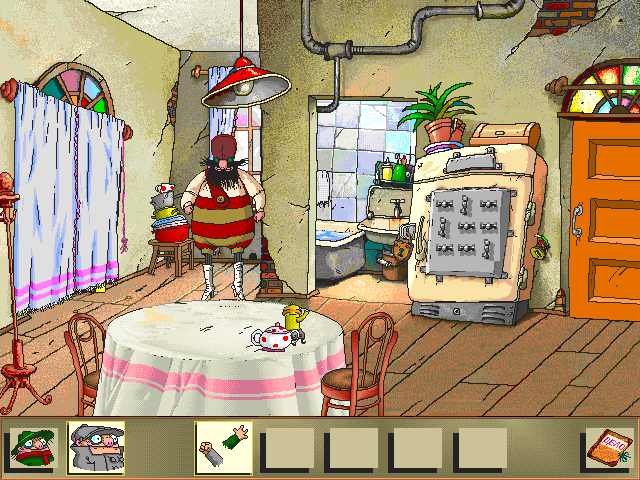
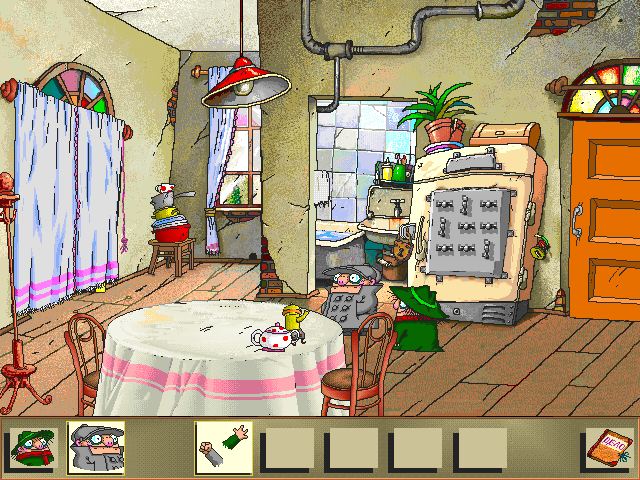

# Замок холодильника и вход в гостиницу — 0.13.2

Исправлены два замечания после испытания 0.13.1 на устройстве.

## Замок поверх корпуса

Замок и корпус холодильника находились в одной плоскости. При одинаковой
глубине порядок объектов в карте приводил к тому, что корпус рисовался
позже и закрывал часть замка.

У поверхности холодильника теперь отдельный приоритет внутри этой
плоскости: сначала корпус, затем его ручка и замок, затем персонаж с такой
же глубиной. Приоритет не переносит корпус через соседние плоскости.
Персонажи по-прежнему проходят перед холодильником и его замком.
Определение объекта под курсором использует тот же приоритет, поэтому
видимая часть замка доступна для взаимодействия.

## Персонажи во вступлении

Перерасчёт глубины накладок стен и двери, добавленный для обычной ходьбы,
больше не применяется во время исходного действия 83 — вступления в
комнату. Эта сцена использует авторские слои и перемещения из оригинального
сценария. До открытия двери персонажи скрыты её непрозрачной накладкой;
когда оригинальный сценарий убирает её, они входят в комнату.
После вступления снова действует исправленный порядок для обычной ходьбы.

Позиции персонажей, условия головоломки, сохранения, музыка, звуки и кадры
анимаций не изменялись.

## Проверки

В `HotelRenderTest` добавлена проверка каждого кадра вступления, пока
присутствует накладка закрытой двери: её цвет сравнивается с результатом
отрисовки во всех непрозрачных местах пересечения с персонажами, которые
по исходному сценарию находятся за дверью. Проверка требует, чтобы такие
пересечения действительно встретились.

После вступления аналогично проверяются все пиксели замка, пересекающиеся
с корпусом холодильника: они должны совпадать с исходным спрайтом замка и
выбираться курсором как замок. Сохранены проверки прохода персонажа перед
замком и стенами, временных слоёв реакций, головоломки и полного сценария
гостиницы.

Полная сборка выполняется для 128×128, 128×160 и 240×320, с CLDC
preverification и регрессионными проверками предыдущих локаций. Это
настольные проверки; испытания версии 0.13.2 на телефоне ещё не проводились.

