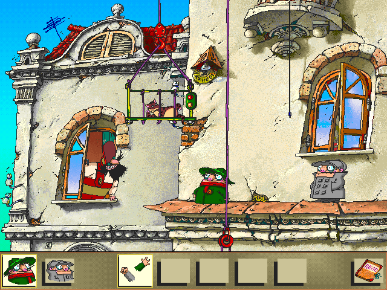

# Единая реакция подъёмника — 0.15.2

Исправлено раздельное воспроизведение реакции подъёмника и персонажа
при ручном подходе на карнизе гостиницы.

В 0.15.1 контроллер подъёмника уже запускал действие 53/54, а путь курсора
продолжал вести выбранного героя дальше. Правила персонажа во время этой
ходьбы пропускались. Поэтому он не выполнял исходную отмену маршрута и
отход на шаге 5: подъёмник двигался и звучал отдельно. При следующем
срабатывании с неподвижным героем сцена уже проигрывалась полностью.

Теперь действия 53/54 приостанавливают ручной маршрут и допускают
исполнение исходных правил выбранного героя. На шаге 5 команда `2a(0)`
отменяет маршрут и запускается отход, на шаге 6 — продолжение реакции.
Текущий шаг ходьбы доигрывается до отхода. Персонаж не идёт дальше по
старому пути после завершения сцены.

Для Коллеги сохранены исходные звуковые события 21 на шаге 5 и 20 на
шаге 21. Эффект подъёмника 18 предусмотрен оригиналом на шагах 8 и 36;
оба события сохранены внутри одного запуска анимации. Кадры, реплики,
правила объектов и условия головоломки не изменялись.

## Проверки

`FacadeWorldTest` проверяет ручной подход и нажатие на окно для обоих
братьев. Требуется ровно один запуск действия, один запуск анимации
подъёмника и один отход. Проверяются точные моменты звуков, отмена
маршрута, отсутствие повторного срабатывания во время ожидания и
последующее прохождение до конца. После каждого такта состояние
сравнивается с восстановленной из сохранения копией.

Дополнительно загружается настоящий снимок 0.15.1 во время ручного подхода
Коллеги: действие 54, счётчик 2, маршрут ещё активен. Он продолжается с
правильной отменой пути и реакцией. Прежние снимки с пропавшими спрайтами
0.15.0 также проверяются.

`FacadeRenderTest` использует ручной подход через рабочий обработчик
ввода и проверяет видимый отход Коллеги ровно один раз. Затем проходит
действия у окна, подбор осколка, трос и совместный уход.

Проверяются три самостоятельных профиля 128×128, 128×160 и 240×320,
CLDC preverification, прежние локации, звук, меню, сохранения и границы
отрисовки. Сверка JAR с 0.15.1 подтвердила, что изменены только
версия в манифесте и класс `HotelWorld`; все остальные ресурсы совпадают
побайтово. Это проверки JVM; проверка 0.15.2 на устройствах предстоит.

