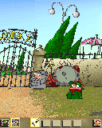

# Раздельные профили — 0.9.1

128×128 и 128×160 теперь выпускаются и проверяются как отдельные приложения.
Профиль 240×320 также сохранён.

| Целевой экран | JAR | Имя приложения |
|---|---|---|
| 128×128 | [Pilots-128x128.jar](../j2me/dist/Pilots-128x128.jar) | Pilots Engine 128x128 |
| 128×160, Nokia C1-02 | [Pilots-128x160.jar](../j2me/dist/Pilots-128x160.jar) | Pilots Engine 128x160 |
| 240×320 | [Pilots-240x320.jar](../j2me/dist/Pilots-240x320.jar) | Pilots Engine 240x320 |

Для каждого профиля создаются собственные JAD, отчёт, снимки отрисовки
и запись статической описи. Разные `MIDlet-Name` при одинаковом поставщике
дают независимые MIDlet suites: установка одного профиля не заменяет другой.
Имена существующих приложений 128×128 и 240×320 сохранены для обновлений.
Новая 128×160 получает собственное хранилище RMS; сохранения из 128×128
автоматически в неё не переносятся.

[profiles.json](../j2me/profiles.json) задаёт исходный ресурсный профиль,
целевой экран, имя приложения и лимит графического кэша. В манифест и JAD
включаются `Pilots-Profile`, `Pilots-Screen` и `Pilots-Raster-Cache-Pixels`;
движок использует заданный лимит кэша. Это позволяет менять параметры
и ресурсную базу одного профиля независимо от остальных.

Исходного JAR 128×160 пользователь не предоставлял: этот профиль использует
закреплённые ресурсы исходного 128×128 и собственную конфигурацию сборки.
Низкоразрешённые фоны, исходные координаты и сжатые анимации сохранены.
Общая Java-логика и механики остаются едиными, чтобы исправления одинаково
работали во всех профилях. Отрисовка учитывает фактический размер Canvas;
искусственных полос или жёсткого ограничения высоты не добавлено.

Сборка одного профиля:

```sh
./j2me/build.sh --profile 128x128
./j2me/build.sh --profile 128x160
./j2me/build.sh --profile 240x320
```

Без `--profile` собираются все три. Полный JDK задаётся через `JAVA_HOME`,
как описано в [инструкции сборки](../j2me/README.md).
Исторический `build.py` по-прежнему работает с двумя исходными JAR 0.3.2.

Каждая сборка проходит проверки игровых правил, сохранений, звука,
всех 3819 кадров и отрисовки сцены/панели при своём целевом разрешении.
Дополнительная проверка `BuildProfilesTest.py` сравнивает JAD с манифестом,
различимость имён при установке, конфигурации и идентичность общего движка.
На реальном устройстве 0.9.1 пока не проверялась; следующий тест Nokia
C1-02 следует выполнять именно с `Pilots-128x160.jar`.


