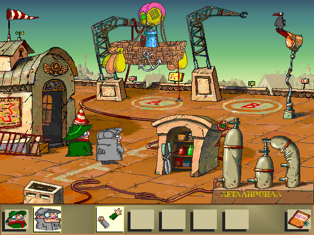
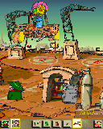
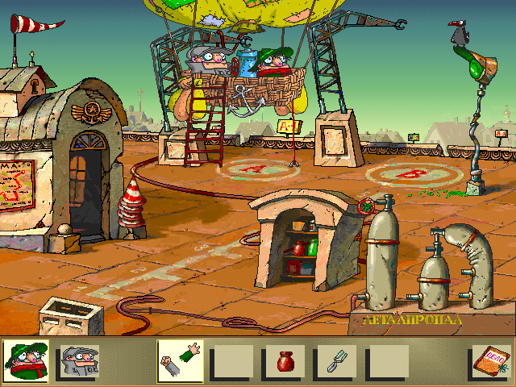

# Крыша с воздушным шаром — 0.20.0

Следующая после подвала локация восстановлена из секции 16 `PILOTS.EXE`
(сцена 14 движка). Порядок следует исходному вызову `0e(14)` из подвала,
а не порядку секций файла. После завершения обоих выходов из подвала
крыша загружается автоматически. В подменю «Локации» добавлена «Крыша».
Канализация остаётся исключённой.

## Объекты → анимации → позиции

Упакованы 49 определений объектов и 416 правил, исходная начальная карта,
150 карт условий и замен. Контроллер 13 с двуязычными подписями заменён
русскими подписями интерфейса; игровые предикаты и тела правил сохранены.

| Объект | ID оригинала |
| --- | --- |
| Коллега / Шеф на крыше | 11 / 12 |
| Зелёная / красная краска на полке | 15 / 16 |
| Шар с установленной лестницей / без неё | 17 / 18 |
| Краски в инвентаре | 19 / 20 |
| Лестница в инвентаре / на крыше | 21 / 23 |
| Килоперьев у светофора | 22 |
| Фишка | 25 |
| Вытяжка / кран / ножницы | 26 / 27 / 28 |
| Ножницы в инвентаре | 31 |
| Верёвка шара | 35 |
| Шланг после подготовки | 39 |
| Коллега / Шеф внутри корзины | 46 / 47 |

Добавлены 111 общих и местных клипов, 1422 кадра с оригинальными пикселями,
палитрами и опорными точками. Сохраняются маски фона и исходная сетка 64×16.
Глубина ходьбы соответствует исходному изменению слоя на 3 при шаге по Y.
Братья в корзине используют отдельные исходные объекты: панель выбора
и камера учитывают их вместо уже удалённых наземных фигур.

Список предпросмотра очищен: доступны только 32 многокадровых клипа крыши.
Ресурсы предыдущих сцен остаются в сборке.

## Взаимодействия и управление

Сохраняются исходные варианты правильных и неправильных действий: получение
обеих красок, их применение к светофору, лестница, ножницы, согласованная
работа братьев с краном и шлангом, наполнение шара, посадка и отрезание верёвки.
Условия решения исполняются исходным байткодом, без подстановки переменных
прохождения. Неправильный цвет не считается правильным решением.

Шеф должен находиться у свободного конца шланга, прежде чем Коллега
сможет подготовить подачу воздуха. Исходное условие проверяет клетку
`(6,24)`, то есть точку `(384,384)` фона. После подготовки Шеф соединяет
шланг с шаром. Финал требует подготовленного шара, зелёного светофора,
обоих братьев в корзине и ножниц у Коллеги.

Четыре предмета отображаются оригинальными иконками в нижних квадратах.
Лестница занимает следующий квадрат после ножниц. Клавиша `7` перебирает
все доступные предметы, `#` открывает полный инвентарь. Остальное управление
сохранено. Нажатие на свободное место при выбранном брате в корзине
сначала запускает его исходный спуск, затем маршрут по крыше.

Для правил крыши добавлено чтение знакового байта глобальной переменной
(опкод `2f`, обработчик `00409000` оригинального интерпретатора).
Состояние исходного нажатия передаётся контроллеру 45 на один такт.
Повторное подтверждение его карты не пересоздаёт контроллер до обработки
нажатия. Для краски на верёвке при обоих братьях в корзине используется
исходная реакция отказа: у оригинального объекта 35 нет завершающей ветки
для этой комбинации. При финальном вызове следующей сцены удаляется
возвращаемая поза Коллеги, чтобы после отлёта не оставалась отдельная голова.

Смена обычного персонажа на фигуру в корзине завершается до разрешения
следующего нажатия, чтобы не прерывать исходную замену объектов.

## Звук, диалоги и сохранения

Добавлены 45 WAV с исходными PCM-сэмплами 11025 Гц и музыка длительностью
82,28 секунды, 7103 MIDI-события. Реплики и звуки действий запускаются
исходными правилами, включая вступление и отлёт. Русские подписи объектов
и существующие текстовые реакции братьев доступны сверху. Новая расшифровка
всех озвученных реплик не создавалась.

Состояние крыши сохраняется в HWS1 с отдельным банком исходных глобальных
переменных, объектами корзины, анимациями и маршрутом. Предыдущие форматы
сохранений поддерживаются. Следующая за крышей сцена пока не включена;
после отлёта показывается завершение локации.

## Проверки

- `RoofWorldTest`: вступление, ошибочные действия, красная и зелёная ветки,
  предметы, кооперация у шланга, обе фигуры в корзине, спуск и повторная
  посадка, полный отлёт. После каждого такта состояние сравнивается с копией,
  заново восстановленной из сохранения.
- `RoofRenderTest`: полный маршрут через непрозрачные хотспоты настоящих
  спрайтов, подписи, четыре предмета в панели, выбор братьев в корзине,
  отрисовка вступления, подготовки и отлёта для трёх разрешений.
- `LocationEntryTest`: автоматический переход из подвала, запуск через
  подменю, RMS-сохранение и восстановление крыши, новый предпросмотр.
- `RoofAssetsTest.py`: независимая сверка каждого пикселя и опорной точки,
  определений, правил и карт с оригинальным EXE. Общая сборка дополнительно
  проверяет PCM/MIDI, CLDC preverification и прежние локации.

Полная сборка трёх профилей прошла. Для каждой версии проверены CRC,
размер из JAD и SHA-256. 1830 прежних ресурсов побайтово совпадают с 0.19.3;
изменён каталог локаций, а список анимаций подвала заменён списком крыши.
Отчёты: `j2me/analysis/roof-assets-audit.json` и `roof-release-audit.json`.

Это проверки на JVM; требуется проверка трёх сборок на устройствах.

