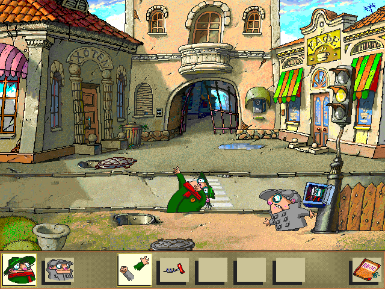

# Прыжок Коллеги в люк, 0.11.1

При уходе через открытый люк в 0.11.0 обычный объект Коллеги удалялся,
но его исходный сценарий удаления не выполнялся. Поэтому спрайт исчезал,
а звук, запускаемый отдельным правилом Шефа, продолжал воспроизводиться.

У исходного объекта 11 обработчик удаления запускает клип **79**, состоящий
из **17 кадров**. Теперь удаление персонажа вызывает этот обработчик:
клип остаётся отдельным временным спрайтом с прежней опорой и слоем,
проигрывается до конца, затем освобождается. Уход Шефа и условия завершения
локации остаются прежними. Игровые ресурсы и формат сохранений SWS1 не изменены.

`StreetWorldTest` на опубликованной 0.11.0 воспроизвёл ошибку:
`Colleague exit animation missing at sewer step 21`.
Проверка теперь требует все 17 кадров на исходных шагах 21–37 и проверяет
восстановление состояния после каждого тика. `StreetRenderTest` проверяет
создание и видимость настоящего `AnimatedActor` для каждого кадра клипа,
затем завершение ухода обоих братьев.

Полная сборка и проверки прошли для трёх профилей: 128×128, 128×160 и 240×320.
Сравнение JAR подтвердило: изменены только класс StreetWorld и версия манифеста;
все игровые ресурсы совпадают с 0.11.0.
Проверки настольные; отображение на телефоне требует пользовательского теста.
