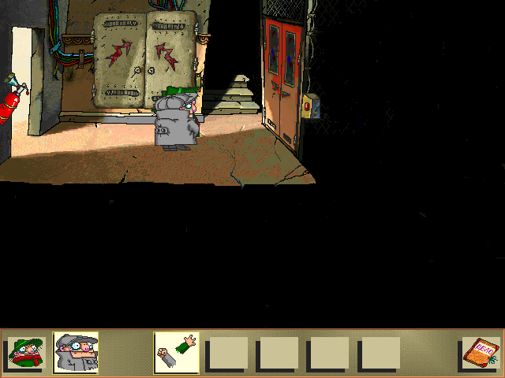
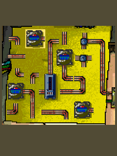
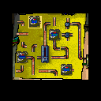

# Электрощитовая — 0.17.0

Перенесена следующая после ванной локация: секция 15 `PILOTS.EXE`,
сцена 13 движка J2ME. После выхода обоих братьев из ванной она загружается
автоматически. Прямой запуск добавлен в подменю «Локации». Канализация
по-прежнему исключена из маршрута.

## Объекты, анимации и позиции

Перенесены исходные определения объектов, начальная карта, карты замен,
группы проходов, условия взаимодействий и сценарии персонажей.

| Объект | Исходный ID |
| --- | --- |
| Шеф / Коллега | 12 / 11 |
| Огнетушитель в инвентаре / на стене | 15 / 51 |
| Поворотные участки проводки | 16–42 |
| Щит и его открытая/восстановленная оболочка | 48 / 49 / 50 |
| Кнопка лифта | 52 |
| Контроллеры восстановления питания и выхода | 55 / 62 |

Добавлены 209 клипов, всего 1465 кадров. Исходные палитры, пиксели,
опорные точки и последовательности сохранены. В списке проверки анимаций
теперь только 40 многокадровых клипов электрощитовой; каталог ванной убран.
Ресурсы предыдущих игровых сцен остаются в JAR.

Глубина обычной ходьбы — `30 − y/8`: два слоя на вертикальный шаг
16 пикселей. Вступление использует исходные составные анимации 178/179,
затем управление получают отдельные персонажи. При создании им сразу
назначаются видимые позы; подходы обоих братьев завершаются до приёма
нового действия. Сценарные поправки к слоям сохранены.

## Отдельный экран проводки

Коллега открывает щит. Шеф подходит к нему по исходному маршруту, после
чего открывается подробный экран. Открытие экрана само не поворачивает
первый участок. Условия выбора героя, предмета и доступности щита остаются
в исходных сценариях.

Вид содержит оригинальный фрагмент фона `(124,24,128,112)` и исходные
спрайты проводки в авторском расположении. Масштаб выбирается под экран
128×128, 128×160 или 240×320. Выбранный участок выделен цветом; отдельные
рамки вокруг элементов не добавлены.

- `2/4/6/8` или направления джойстика выбирают соседний участок.
- `5` или центральная кнопка поворачивают его.
- На сенсорном экране участок выбирается и поворачивается нажатием.
- `0` или «Назад» возвращают в комнату с сохранением прогресса.

Схема состоит из 27 участков. Восемь прямых участков имеют два положения,
остальные девятнадцать — четыре. Каждый поворот выполняет исходный
сценарий Шефа, включая событие поворота и проверку электрических цепей.
Подсветку соединённых частей определяют исходные предикаты и спрайты.
Проверка решения не заменена новой формулой: исходный контроллер запускает
действие 97, когда выполнены все четыре группы условий.

После правильного решения подробный экран закрывается автоматически,
акторы комнаты обновляются и продолжается исходная сцена восстановления
питания. При обычном выборе участка мир приостановлен; поворот выполняет
только соответствующую последовательность исходных тактов.

## Взаимодействия, реплики и выход

Перенесены разные реакции братьев на щит, огнетушитель и кнопку лифта,
взятие огнетушителя, его использование, состояния электрики, лифта и
завершающие анимации. Значок огнетушителя отображается в нижней строке и
доступен в меню предметов. Братья подходят к выходу по исходным маркерам.
Финальный контроллер ждёт прибытия обоих, запускает исходную общую
анимацию 204 и завершает сцену вызовом `0e(15)`.

Добавлены 31 WAV и MIDI длительностью 90,30 секунды. Звуки, реплики,
повороты проводов, электрика и события лифта запускаются исходными
сценариями. Отдельная новая расшифровка аудиореплик не добавлялась.
Подписи интерактивных объектов русские: «Щит», «Провода», «Огнетушитель»,
«Лифт». Добавлена справка по управлению подробным экраном.

## Сохранения и проверки

Тридцать два больших глобальных адреса секции `0x1e1b54`–`0x1e1bd0`
сохраняются в отдельном банке этой сцены: положения 27 участков и состояния
электрики/выхода не перекрывают старые переменные. В снимок HWS1 сцены 13
добавлен соответствующий хвост из 32 целых чисел. Форматы прежних сцен
не менялись. Сохранение посреди подробного экрана восстанавливает его
с теми же положениями проводов.

`SwitchboardWorldTest` проходит вступление, открытие щита, отказ для
неподходящего героя, исходные повороты всех типов участков, паузу и
повторное открытие экрана, решение и выход обоих братьев. Состояния
сравниваются с копиями после восстановления сохранений, включая атомарные
повороты внутри подробного экрана.

`SwitchboardRenderTest` использует реальные непрозрачные хотспоты комнаты,
проверяет подписи, исходные слои, увеличенную графику и доступность всех
пар участков через стрелки. Далее проходит решение, значок огнетушителя
и полный выход.

`LocationEntryTest` проверяет переход из ванной, подменю, открытие реального
`SwitchboardCanvas`, поворот клавишей `5`, выход клавишей `0`, сохранение
в RMS, восстановление подробного экрана и решение через направления и
центральную кнопку с автоматическим возвратом в комнату.

Полная сборка включает 1236 клипов / 14329 кадров, 394 WAV и 12 MIDI,
проверки предыдущих локаций, границ отрисовки, меню, сохранений и CLDC
preverification для трёх отдельных профилей. Это проверки на JVM;
проверка 0.17.0 на устройствах предстоит.

Независимая сверка готовых JAR с секцией 15 подтвердила все 209 клипов /
1465 кадров, пиксели, палитры и опорные точки, исходный фрагмент щита,
байткод и PCM всех 31 звукового события. В каждом профиле 1446 прежних
ресурсов побайтово совпадают с 0.16.2; проверены каталог сцен, CRC и JAD.

