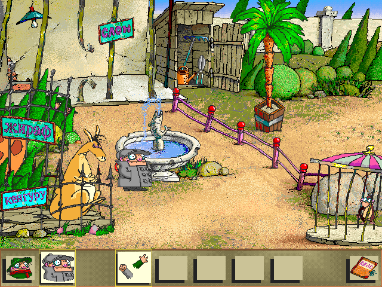

# Третья локация: звериный двор — 0.8.0

Сборки: [128×128](../j2me/dist/Pilots-128x128.jar),
[240×320](../j2me/dist/Pilots-240x320.jar).

Прохождение теперь последовательно открывает три локации:
ворота → двор с роялем → звериный двор. Переход выполняется после
завершения выходного действия. Пункт меню «Третья локация» позволяет
открыть новую сцену отдельно. Четвёртая локация пока не загружается.

## Объекты → анимации → позиции

Источник новой сцены — секция 6 закреплённого `PILOTS.EXE`:
65 локальных типов объектов, 93 локальные анимации и исходные карты изменений.
[Извлечение](../j2me/extract_animals.py) сохраняет исходные байткоды
предикатов и действий вместе с метаданными правил. В движок включены
общие объекты и позы персонажей; всего описаны 75 типов и 482 правила.
Объект 15 с оконным выводом подписей заменён строкой подсказки J2ME.

Перенесены вступительная сцена, лейка, грабли, секатор, пальма, бананы,
носорог, фонтан и кран, кенгуру, птица, клетки и передние планы.
Корни спрайтов, палитра, смещения кадров и слои берутся из оригинальных
записей объектов, начальной карты и сценарных изменений.

Старые каталоги проверки `02.animations` и `03.animations` удалены из сборки.
В меню «Анимации» только **46 анимаций третьей локации**, с новой нумерацией
01–46. Сама игра продолжает использовать исходные номера спрайтов.
Прежние игровые анимации первых двух сцен сохранены.

## Взаимодействия и диалоги

`AnimalWorld` исполняет упакованные исходные правила новой сцены:
условия персонажа и выбранного предмета, счётчики, реакции, создание
и удаление объектов, смену слоёв и состояния фонтана. Native 00 продолжает
проверку следующего правила; обычное принятое правило завершает обработку
объекта на текущем такте. Старший бит метаданных отмечает конец списка правил.
Объекты обрабатываются в порядке создания, независимо от порядка рисования.

Windows-ввод, вывод подсказок и поиск пути адаптированы к J2ME.
Действие начинается после подхода к исходной точке взаимодействия.
Для ходьбы используется ограниченный BFS по сетке 16 пикселей и исходным
занятым ячейкам; это адаптация, а не перенос нативного алгоритма GMW.
Занимающий точку второй персонаж отходит рядом, после чего управление
возвращается инициатору действия. Отдельно обработаны подходы вступления,
освобождение места приземления и маршрут выхода после прыжка кенгуру.

В нижней строке показываются персонажи, рука и полученные предметы:
**лейка, грабли, секатор**. Иконки и действия соответствуют этой сцене;
предметы первой локации здесь не показываются. Особое положение Коллеги
на пальме и его временная недоступность после некоторых действий сохраняются.

Добавлены 62 WAV и MIDI новой сцены. Всего в сборке 125 WAV и три MIDI;
ресурсы общих звуков повторяются в пространствах имён сцен.
Музыка третьей локации длится 109,58 секунды. Звуковые вызовы из её
сценариев исполняются напрямую, включая вступление, предметы, животных,
фонтан и выход. Сохраняется общий переключатель звука и пауза MMAPI.

Для разборчивых речевых событий показываются «Ничего не понимаю»
обоих персонажей и «Спелый!» в сценах с бананами. Остальные звуковые
реакции не заменены придуманными репликами. Подсказки объектов восстановлены
из оригинальных названий; общая опись аудио доступна
[здесь](../j2me/analysis/audio-original-cues.json).

## Переходы и сохранения

Общий `SceneFlow` вызывается из игрового такта Canvas:
после прохождения ворот сцена 02 открывает 03; после выхода из двора
с роялем сцена 03 открывает 04. Незавершённое действие не меняет локацию.
Новая сцена получает своё начальное состояние и новый аудиоконтекст.

Старые сохранения первых двух локаций в формате PSV1 читаются без изменений.
Для третьей используется расширение PSV2: карта объектов, их локальные
переменные, текущие клипы и кадры, видимость персонажей, выбранный предмет,
субтитры и полный маршрут ходьбы с его текущим шагом. Сохраняются также
промежуточные стадии вступления, совместных действий и фонтана.
Музыка при загрузке запускается заново, прошедшие одноразовые звуки не повторяются.

## Проверка

Для обоих профилей проходят прежние проверки ворот и рояля, включая
сопоставление завершения с переходом в следующую сцену. Для звериного двора:

- полная цепочка предметов, пальмы, носорога, бананов, фонтана и кенгуру до выхода;
- все четыре состояния фонтана и освобождение занятых точек приземления;
- подбор всех трёх предметов каждым персонажем и сохранение выбора после отхода;
- неверное действие Коллеги при поливе пальмы;
- сохранение и загрузка посреди ходьбы и сценарных действий;
- сравнение состояния при загрузке на каждом такте с непрерывным исполнением;
- отсутствие старых списков проверки анимаций;
- настоящий рендер сцены, выросшей пальмы и новой панели обоих разрешений;
- исходные PCM, все MIDI-сообщения и их время, жизненный цикл MMAPI.

[Опись правил](../j2me/analysis/animals-original-rules.json) содержит смещения,
байткоды, исходные позиции и параметры клипов.

Проверки выполнены на JVM с графическим и MMAPI-адаптерами.
На телефоне или эмуляторе новая локация ещё не проверялась.

## Последовательность для проверки полного прохождения

1. Собрать лейку, грабли и секатор; Шефом полить пальму.
2. Оставить Шефа у пальмы, Коллегой попробовать достать бананы.
3. Шефом применить грабли к звериной тропе, затем вернуть его к пальме.
4. Коллегой ещё раз достать бананы — он окажется на пальме.
5. Шефом один раз повернуть кран; Коллегой с секатором срезать бананы.
6. Шефом снова повернуть кран и воспользоваться кенгуру слева.
7. Дождаться завершения прыжка и подхода к выходу.
